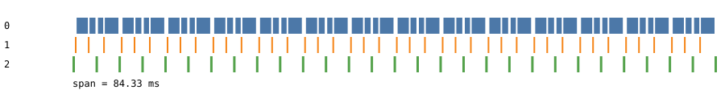
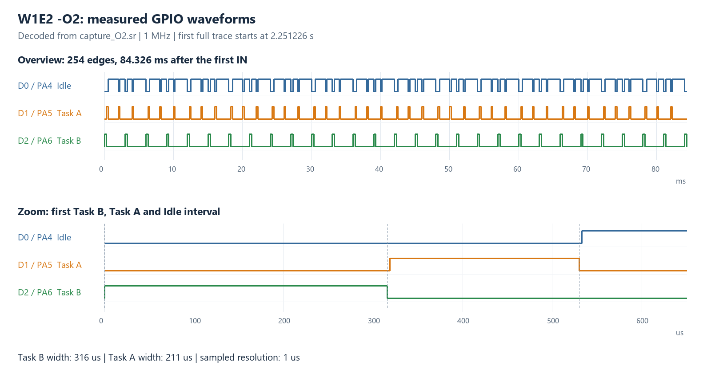

# W1.2 – REPORT

- **Trạng thái: DONE — đã hoàn thành triển khai, build và đo task set của W1E2**
- MSSV: 2452882; ngày đo lại: 16/10/2026
## Số đo

**Cấu hình**

- STM32F103C8, Cortex-M3, HCLK danh định 72 MHz, 72 cycles = 1 µs
- Arm GNU GCC 14.2.1, CMake + Ninja, `-Wall -Wextra -Werror`
- Preset `w1e2-o0`: Debug, `-O0 -g3`; preset `w1e2-o2`: Debug, `-O2 -g3`
- FreeRTOS tick 1000 Hz; Task A/B cùng priority 1, Idle priority 0
- A: tag 1, busy-wait 200 µs, period 2 ms; B: tag 2, busy-wait 300 µs, period 3 ms
- UART1 PA9 TX: 115200 baud, 8N1, COM19 khi thu dữ liệu
- Logic Analyzer: PulseView, 1 MHz, 10 triệu samples trong 10 giây

| Task | Tag | GPIO | Kênh Logic Analyzer |
| --- | ---: | --- | --- |
| Idle | 0 | PA4 | D0 |
| Task A | 1 | PA5 | D1 |
| Task B | 2 | PA6 | D2 |

`traceTASK_SWITCHED_IN/OUT` gọi tracer. Hook đọc `DWT->CYCCNT` tại
đầu hàm, lấy application tag, ghi BSRR/BRR và static ring buffer.
GPIO HIGH tại IN, LOW tại OUT. Không malloc hoặc gửi UART trong hook.

Buffer 256 slots giữ một slot để phân biệt đầy/rỗng, dừng sau OUT
trước khi hết chỗ. Capture nguyên vẹn có 254 records, `overflow=0`,
đầu IN, cuối OUT; sau freeze Task B dump UART một lần.

Định dạng CSV: `timestamp_cycles,task_tag,IN|OUT`; dòng `#` là metadata.
Record RAM giữ timestamp 32-bit; lúc dump mở rộng qua wrap thành
số cycles 64-bit. Trong cửa sổ đo này không xảy ra CYCCNT wrap.

**Bảng thời gian OUT → next IN của firmware mới**

| Optimization | min (cycle) | max (cycle) | jitter = max-min |
| --- | ---: | ---: | ---: |
| -O0 | 438 | 508 | 70 |
| -O2 | 219 | 244 | 25 |

Mỗi cấu hình có 126 mẫu OUT → next IN, tương ứng 127 cặp IN/OUT.

| Optimization | min (µs) | max (µs) | mean (cycle) | mean (µs) |
| --- | ---: | ---: | ---: | ---: |
| -O0 | 6,083 | 7,056 | 472,841 | 6,567 |
| -O2 | 3,042 | 3,389 | 232,206 | 3,225 |

Đây là khoảng giữa hai timestamp hook, gồm phần thân OUT còn lại,
scheduler và phần đầu IN đến timestamp. Không bao phủ toàn bộ
exception entry/exit hoặc PendSV save/restore. Vùng HIGH có thể chứa
ISR, không phải exclusive task CPU time.

**Gantt và waveform của lần đo mới**






Hình waveform được dựng từ samples thật trong `capture_O2.sr`, không
phải ảnh chụp giao diện PulseView hoặc waveform mô phỏng. Phần trên
là cụm đầu tiên đủ 254 cạnh, phần dưới zoom 650 µs đầu. Có thể mở
session gốc trong PulseView để kiểm tra lại cùng các cạnh.

Ở cụm này, Task B HIGH 316 µs, Task A HIGH 211 µs; tính từ DWT tương
ứng 316,042 và 210,597 µs. Khoảng GPIO từ B OUT đến A IN là 3 µs,
trong khi khoảng timestamp là 238 cycles = 3,306 µs.

**Dữ liệu và xử lý log thu nhiều lần RESET**

Tất cả bằng chứng hiện tại đặt trong `measure_20261016_075333/`:

- [CSV -O0, một capture đầy đủ](measure_20261016_075333/trace_O0.csv)
- [CSV -O2, capture đầy đủ được chọn](measure_20261016_075333/trace_O2.csv)
- [UART -O2 thô, giữ nguyên bytes](measure_20261016_075333/uart_O2_raw.txt)
- [Session Logic Analyzer gốc](measure_20261016_075333/capture_O2.sr)
- [Kết quả correlation](measure_20261016_075333/correlation_O2.json)
- [Thống kê, SHA256 và provenance](measure_20261016_075333/measurement_summary.json)
- [Disassembly -O0](measure_20261016_075333/disassembly_O0.txt)
- [Disassembly -O2](measure_20261016_075333/disassembly_O2.txt)

UART thô có 13 header: 6 capture đủ 254 records, 7 capture bị ngắt,
một số dừng giữa dòng. Sáu capture đủ giống nhau về timestamp/tag/event.
CSV -O2 chính là capture nguyên vẹn đầu tiên, không ghép records từ
nhiều lần RESET, không sửa nội dung dòng hỏng để ép PASS. Log thô và
thống kê từng block được giữ để truy vết quyết định chọn dữ liệu.

Session có 12 cụm GPIO đầy đủ. Một template UART nguyên vẹn khớp từng
cụm về 254 tag/chiều cạnh và thời gian tương đối. Không có ID RESET
chung giữa UART và LA nên không khẳng định ghép định danh từng lần
thu UART với từng cụm; kết quả là đối chiếu template lặp lại được.

**Lệnh tái kiểm tra**

Chạy từ repo root bằng Python 3 hợp lệ:

```text
cmake --preset w1e2-o0
cmake --build --preset w1e2-o0
cmake --preset w1e2-o2
cmake --build --preset w1e2-o2
python tools/trace_gantt.py week1/ex2/measure_20261016_075333/trace_O0.csv --freq-hz 72000000
python tools/trace_gantt.py week1/ex2/measure_20261016_075333/trace_O2.csv --freq-hz 72000000 --params-h week1/ex2/include/params.h
python tools/trace_correlate.py week1/ex2/measure_20261016_075333/capture_O2.sr week1/ex2/measure_20261016_075333/trace_O2.csv
```

Script correlation stdlib-only đọc sigrok v2, kiểm tra thứ tự/cặp UART,
không sort timestamps lỗi, không fit clock scale. Exit 0: đạt ngưỡng
căn cạnh đầu; exit 1: vượt ngưỡng; exit 2: dữ liệu không hợp lệ.
Không đưa log UART thô nhiều RESET trực tiếp vào `trace_gantt.py`.

Hai build mới kiểm tra lại đều thành công. API checker full scope
`platform week1 week2 week3 week4`:

```text
check_api: PASS (53 files)
```

Bộ host test bổ sung đã được chạy ở giai đoạn sửa review; sau đó xóa
khỏi repo theo yêu cầu dọn bài. Không có lệnh/link đến test đã xóa.
Các kiểm tra hiện tái lập bằng build, API checker và hai script trên.

## Giải thích sai lệch (ĐỊNH LƯỢNG)

**1. Gantt so với Logic Analyzer**

Với mỗi cụm GPIO, lấy IN đầu của Task B làm mốc:

```text
t_DWT(i) = (cycles_i - cycles_0) / 72                [µs]
t_LA(i)  = (sample_i - sample_0) / 1 MHz × 10^6      [µs]
d_i      = t_LA(i) - t_DWT(i)
```

Chỉ dịch origin, không co giãn trục thời gian. Các cạnh khởi tạo trước
trace và đoạn capture thiếu nằm ngoài cửa sổ 254-event được chọn;
không bỏ một cạnh bên trong cửa sổ để làm khớp template.

| Cụm GPIO | Origin LA (ms) | max abs(d_i), căn cạnh đầu (µs) | max residual sau fit mean PendSV (µs) |
| --- | ---: | ---: | ---: |
| 1 | 2251,226 | 1,347 | 0,744 |
| 2 | 3797,169 | 1,347 | 0,744 |
| 3 | 4454,719 | 1,556 | 0,608 |
| 4 | 5105,788 | 1,556 | 0,796 |
| 5 | 5719,041 | 1,556 | 0,695 |
| 6 | 6276,437 | 1,708 | 0,690 |
| 7 | 6830,867 | 1,347 | 0,702 |
| 8 | 7401,493 | 1,097 | 0,763 |
| 9 | 7924,701 | 1,097 | 0,699 |
| 10 | 8395,575 | 1,556 | 0,628 |
| 11 | 8967,935 | 1,556 | 0,721 |
| 12 | 9493,947 | 1,556 | 0,628 |

Max căn cạnh đầu trên 12 cụm là **1,708 µs ≤ 16 µs**,
đạt `W1E2_CORRELATION_TOLERANCE_US`.

Event IN đầu chạy ở thread mode từ `vTaskStartScheduler`; 253 event
còn lại chạy trong PendSV. Script báo thêm fit offset hằng theo mean
của 253 event PendSV, loại event đầu khỏi tập fit và thống kê đó.
Residual lớn nhất của tập PendSV sau fit là khoảng 0,796 µs.

PASS vẫn dùng max căn cạnh đầu, không dùng mean fit để che outlier.
Sampling 1 MHz có bước 1 µs. Residual nhỏ hơn 1 µs không phải chứng
nhận độ chính xác vật lý dưới 1 µs; latency timestamp → GPIO, pha
lấy mẫu và timebase đều có ảnh hưởng. Không hiệu chuẩn HSE/LA từ dữ
liệu này hoặc dùng nó để kết luận nguyên nhân sai lệch W1.1.

**2. So sánh -O0 và -O2 bằng disassembly hiện tại**

Mean giảm 472,841 → 232,206 cycles, chênh 240,635 cycles ≈ 3,342 µs,
mean giảm khoảng 50,9% khi chuyển từ -O0 sang -O2 với cùng task set.

| Hàm trong firmware mới | -O0 (bytes) | -O2 (bytes) |
| --- | ---: | ---: |
| `tracer_current_tag` | 82 | 50 |
| `tracer_record` / bản local do compiler tạo | 228 | 204 |
| `tracer_on_switched_out` | 60 | 44 |
| `vTaskSwitchContext` | 180 | 128 |

Kích thước code không phải cycle count. Đoạn hook OUT -O0 có stack
frame và lưu/đọc timestamp qua stack:

```asm
push    {r7, lr}
sub     sp, #8
...
str     r3, [r7, #4]
...
ldr     r0, [r7, #4]
bl      tracer_record
```

Ở -O2, timestamp giữ trong r4, ít thao tác stack hơn và tail-call
sang hàm local `tracer_record.isra.0`:

```asm
push    {r4, lr}
ldr     r4, [r2, #4]
...
mov     r0, r4
ldmia.w sp!, {r4, lr}
b.w     tracer_record.isra.0
```

Trong hook, GPIO được ghi trực tiếp bằng BSRR/BRR, không gọi
`gpio_set/clear`. Hàm producer là static; compiler có thể chuyên biệt
hóa nó. Không gọi việc này là toàn bộ `tracer_record` đã inline vì
ELF -O2 vẫn có hàm local riêng.

PendSV giữ các thao tác chính save/restore register. Phần giảm thời
gian gồm scheduler C và instrumentation; không quy toàn bộ chênh
240,635 cycles cho một hàm. DMB đảm bảo thứ tự memory access, và
intrinsic có compiler memory clobber; không thay giả định một producer.

**3. Jitter và đường xử lý phụ thuộc task**

| Hướng switch | Số mẫu | -O0 min–max (cycles) | -O2 min–max (cycles) |
| --- | ---: | ---: | ---: |
| Idle → A | 28 | 438 | 219 |
| Idle → B | 28 | 438 | 219 |
| B → A | 14 | 472 | 238 |
| A → Idle | 42 | 502–508 | 242–244 |
| B → Idle | 14 | 508 | 244 |

Jitter -O2 = 244 - 219 = **25 cycles ≈ 0,347 µs**,
nhỏ hơn `W1E2_CTXSW_JITTER_MAX_CYCLES_O2 = 355` → PASS.

Idle → A/B so với B → A chênh 19 cycles ở -O2 và 34 ở -O0.
Disassembly cho thấy tag Idle NULL return sớm, task A/B phải gọi
callback. Đây là bằng chứng có đường instrumentation phụ thuộc tag.
B → A so với B → Idle chênh thêm 6 / 36 cycles; còn có nhánh tìm
priority, ready-list end marker, pipeline và memory access.

Về số học, 25 = 19 + 6 cycles giữa các nhóm, nhưng đây không phải
đo tách độc lập chứng minh 19 cycles chỉ thuộc tracer và 6 chỉ thuộc
kernel. Jitter của toàn tập khác jitter trên một đường: Idle → task
đều 219 cycles, còn A → Idle trải 242–244 cycles ở -O2.

**4. Hiệu quả sửa review và đối chiếu PREDICTION**

| Phiên bản | Mean -O0 (cycles) | Mean -O2 (cycles) | Jitter -O2 (cycles) |
| --- | ---: | ---: | ---: |
| Baseline `d673d5f` | 497,952 | 278,214 | 26 |
| Bản sửa đã đo lại | 472,841 | 232,206 | 25 |

Mean giảm khoảng 5,0% ở -O0 và 16,5% ở -O2 so với baseline.
Baseline chỉ là số lịch sử, artifact cũ có thể xem lại trong Git commit
`d673d5f`. Các file nộp hiện tại thuộc lần đo mới, không trộn ảnh cũ.

| Đại lượng | PREDICTION trước khi chạy | Đo lại firmware mới |
| --- | ---: | ---: |
| -O0 min/max | 300/700 cycles | 438/508 cycles |
| -O2 min/max | 120/350 cycles | 219/244 cycles |
| -O2 jitter | 230 cycles | 25 cycles |
| Max sai lệch căn cạnh đầu | 4 µs | 1,708 µs |

PREDICTION đã tính instrumentation vào phạm vi đo, nhưng budget ban
đầu chưa được xác lập từ implementation: min thực cao hơn dự đoán
138 cycles ở -O0 và 99 ở -O2. Tag getter, callback, barrier, buffer
và scheduler thực tế nặng hơn budget. Chưa đo tách để phân bổ toàn
bộ phần chênh đó cho từng thành phần.

Jitter thấp hơn dự đoán trong task set giới hạn này: chỉ priority 0/1,
không chủ động tạo tải ISR priority cao; trong OUT → IN, BASEPRI =
0x50 che SysTick priority 15. IRQ priority cao hơn ngưỡng, NMI và
HardFault vẫn có thể ảnh hưởng nếu xuất hiện.

Mới có năm hướng switch; chưa khảo sát priority gap ≥2, time slicing
hoặc yield từ ISR. Max 244 cycles không phải bound cho mọi task set.
Sampling thực tế 1 MHz khác giả định 24 MHz trong PREDICTION;
ngưỡng correlation vẫn đạt. Giữ nguyên prediction cũ.

## Trả lời câu hỏi trade-off

Tick 1 ms quyết định Ready/release time, không lượng tử hóa timestamp
DWT: một cycle danh định ≈ 13,89 ns. Khoảng đo -O2 3,042–3,389 µs
không phải bội số 1 ms.

Trong dữ liệu có bằng chứng tracer phụ thuộc tag: callback NULL ở
Idle và callback task tạo các đường khác nhau; hai nhóm chênh 19 cycles
ở -O2, so với độ trải tổng 25 cycles. Vì vậy không diễn giải toàn bộ
jitter như chi phí kernel thuần. Chưa có ablation để xếp hạng riêng
GPIO update và ring-buffer write; phần mean giảm khi đổi optimization
cũng bao gồm scheduler và các helper.

Static buffer, producer private và dump sau freeze giữ UART khỏi
cửa sổ đo. Đổi lại chỉ có một cửa sổ hữu hạn và vẫn có instrumentation
overhead. GPIO/timestamp latency cùng sampling 1 µs ảnh hưởng phép
đối chiếu; residual sau căn offset không đo riêng từng nguồn này.

Tag ngoài GPIO mapping vẫn vào UART, không assert vì tag lạ trong
hook. Mask suy từ FIRST/LAST; tag callback hợp lệ 1..254, NULL dành
cho Idle 0; giá trị callback không hợp lệ thành marker 255. Ứng dụng
phải cung cấp callback nhanh, không blocking.

Unwrap khi dump chỉ khôi phục được khi hai records liên tiếp cách nhau
nhỏ hơn 2^32 cycles ≈ 59,65 s tại 72 MHz. Record đầu không cho biết
số vòng trước đó. Lần đo ~84 ms không kiểm thử wrap dài trên MCU;
kiểm tra wrap bằng host trước đây là kiểm tra logic, không phải
phép đo thực chạy 120 giây.

**Kết quả hoàn thiện**

Code, build, Gantt, UART/LA, bảng -O0/-O2 và phân tích định lượng đã
hoàn thành cho task set này. Hai ngưỡng Output đạt. Phần vấn đáp do
mentor đánh giá trực tiếp; kết quả hữu hạn không chứng minh worst-case
cho mọi tải hoặc task set khác.

**Tham chiếu**

- [sigrok v2](https://sigrok.org/wiki/File_format:Sigrok/v2)
- [CMake presets](https://cmake.org/cmake/help/v3.20/manual/cmake-presets.7.html)
- [CMSIS Core / BASEPRI](https://arm-software.github.io/CMSIS_5/Core/html/group__Core__Register__gr.html)
