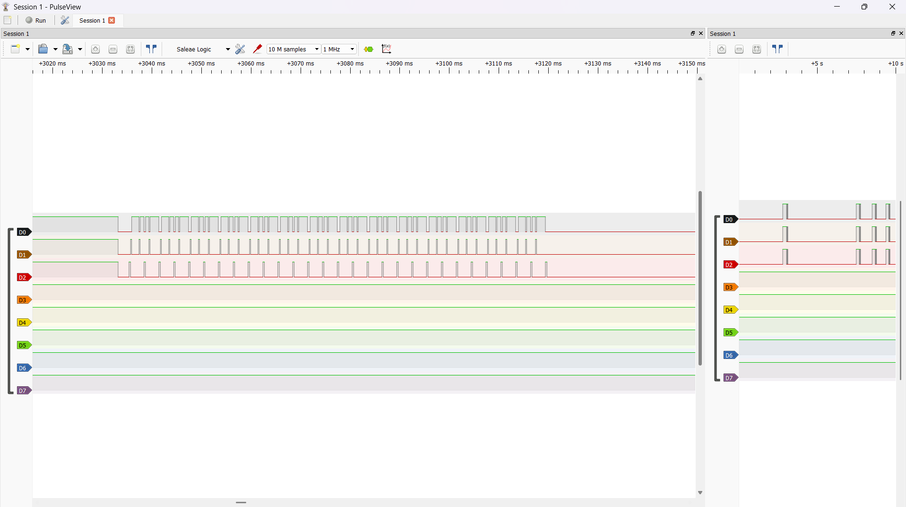
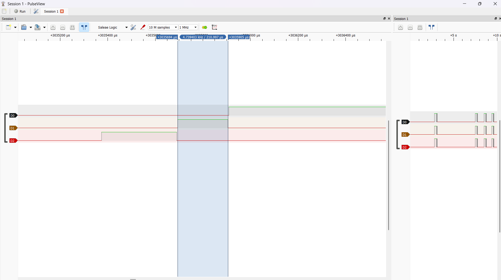

# W1.2 – REPORT

- MSSV: 2452882
- Ngày đo: 15/10/2026
- MCU: STM32F103C8, Cortex-M3, HCLK = 72 MHz
- Toolchain: Arm GNU GCC 14.2.1
- Hai cấu hình build: `-O0 -g3` và `-O2 -g3`
- PREDICTION được commit trước khi triển khai và chạy thử, commit `3fdd85c`

## Số đo

**Cấu hình thí nghiệm**

- FreeRTOS tick rate: 1000 Hz, tương ứng 1 ms/tick
- Task A: tag 1, workload busy-wait 200 µs, period 2 ms
- Task B: tag 2, workload busy-wait 300 µs, period 3 ms
- Hai task cùng priority `tskIDLE_PRIORITY + 1`
- Idle được biểu diễn bằng tag 0
- GPIO mapping: PA4 → Idle, PA5 → Task A, PA6 → Task B
- GPIO HIGH tại hook IN và LOW tại hook OUT
- UART1: PA9 TX, 115200 baud, 8N1
- Logic Analyzer: PulseView, sample rate 1 MHz, cửa sổ thu 10 giây

Tracer sử dụng `traceTASK_SWITCHED_IN()` và
`traceTASK_SWITCHED_OUT()` của FreeRTOS. Mỗi hook đọc
`DWT->CYCCNT`, xác định task tag, cập nhật GPIO và ghi static ring buffer

Ring buffer có capacity 256 slots, giữ một slot để phân biệt đầy/rỗng
và chủ động dừng sau OUT khi còn ít chỗ trống. Mỗi capture thu được
254 records, `overflow=0`, bắt đầu bằng IN và kết thúc bằng OUT

UART chỉ dump khi capture đã dừng, không truyền UART hoặc cấp phát
bộ nhớ trong trace hook

**Định dạng log**

```text
timestamp_cycles,task_tag,IN|OUT
```

- Timestamp là giá trị 32-bit từ `DWT->CYCCNT`
- Task tag: 0 = Idle, 1 = Task A, 2 = Task B
- Các dòng bắt đầu bằng `#` chứa metadata
- Capture dài khoảng 84,33 ms, không xảy ra CYCCNT wrap
- `tools/trace_gantt.py` được sử dụng trực tiếp để phân tích và vẽ Gantt

**Phạm vi đo context switch**

Số liệu dưới đây đo khoảng từ timestamp của OUT đến timestamp của
IN kế tiếp

Khoảng này chứa phần scheduler và instrumentation nằm giữa hai
timestamp, không bao phủ toàn bộ exception entry/exit và save/restore
register của PendSV. Vì vậy, không diễn giải số liệu này thành tổng
latency chuyển context của Cortex-M3

**Bảng context switch**

| Optimization | min (cycle) | max (cycle) | jitter = max-min |
| --- | ---: | ---: | ---: |
| -O0 | 462 | 534 | 72 |
| -O2 | 264 | 290 | 26 |

Mỗi cấu hình có 126 mẫu OUT → next IN

| Optimization | min (µs) | max (µs) | mean (cycle) | mean (µs) |
| --- | ---: | ---: | ---: | ---: |
| -O0 | 6,417 | 7,417 | 498,0 | 6,916 |
| -O2 | 3,667 | 4,028 | 278,2 | 3,864 |

**Gantt và dữ liệu gốc**

Gantt của bản `-O0`:


Gantt của bản `-O2` tương ứng với lần đo Logic Analyzer:


- Log `-O0`: [trace_O0.csv](trace_O0.csv)
- Log `-O2`: [trace_O2.csv](trace_O2.csv)
- Log UART của phiên đo Logic Analyzer: [trace_O2_la.csv](trace_O2_la.csv)
- Capture UART đầu tiên đã tách riêng: [trace_O2_la_single.csv](trace_O2_la_single.csv)
- Dữ liệu Logic Analyzer gốc: [capture_O2.sr](capture_O2.sr)
- Disassembly `-O0`: [disassembly_O0.txt](disassembly_O0.txt)
- Disassembly `-O2`: [disassembly_O2.txt](disassembly_O2.txt)





**Kiểm tra API**

`tools/check_api.sh` đã được chạy với phạm vi `platform week1/ex2`

```text
check_api: PASS (14 files)
```

## Giải thích sai lệch (ĐỊNH LƯỢNG)

**1. Sai lệch Gantt và Logic Analyzer**

Căn thời gian theo cùng một event: IN đầu tiên của Task B,
tương ứng cạnh lên D2 đầu tiên của mỗi capture

```text
t_tracer_us = (timestamp_event - timestamp_mốc) / 72
t_LA_us     = thời_gian_cạnh_event - thời_gian_cạnh_mốc
error_us    = |t_LA_us - t_tracer_us|
```

Chỉ dịch time origin, không co giãn trục thời gian để ép khớp dữ liệu

File `.sr` chứa bốn lần capture. Log UART cũng chứa bốn đoạn,
mỗi đoạn 254 records và có nội dung giống nhau

Đối chiếu lần lượt tag và chiều cạnh trên D0–D2 cho thấy mỗi lần
khớp đủ 254 events, không thiếu hoặc thừa cạnh trong cửa sổ trace.
Các chuyển mức trước khi tracer hoạt động không được tính vào phép so sánh

| Capture | Sai lệch tuyệt đối lớn nhất sau căn mốc (µs) |
| --- | ---: |
| 1 | 1,889 |
| 2 | 1,472 |
| 3 | 1,653 |
| 4 | 1,111 |

Ví dụ tại đầu, giữa và cuối capture thứ nhất:

| Event | Tracer tương đối (µs) | Logic Analyzer tương đối (µs) | Sai lệch (µs) |
| --- | ---: | ---: | ---: |
| Task B OUT đầu tiên | 316,583 | 316 | 0,583 |
| Event 128 | 42328,500 | 42327 | 1,500 |
| Event 254 | 84328,500 | 84327 | 1,500 |

Sai lệch lớn nhất trên toàn bộ dữ liệu đã đối chiếu là khoảng
1,89 µs, nhỏ hơn `W1E2_CORRELATION_TOLERANCE_US = 16 µs` → PASS

Sample rate thực tế là 1 MHz, tương ứng 1 µs/sample. Các chữ số
thập phân trong bảng là kết quả tính toán, không có nghĩa Logic
Analyzer đạt độ chính xác đến nanosecond

Timestamp được đọc trước khi cập nhật GPIO. Vì vậy, cạnh GPIO
xuất hiện muộn hơn thời điểm timestamp; việc căn mốc loại bỏ offset
chung nhưng không loại bỏ biến thiên latency giữa các event

**2. Chênh lệch -O0 và -O2 từ assembly thực tế**

Mean giảm từ khoảng 497,95 xuống 278,21 cycles, tương ứng giảm
219,74 cycles, khoảng 3,05 µs hay 44,1%

Disassembly cho thấy:

| Hàm | Kích thước -O0 (bytes) | Kích thước -O2 (bytes) |
| --- | ---: | ---: |
| `gpio_set` | 38 | 12 |
| `tracer_on_switched_out` | 60 | 44 |
| `vTaskSwitchContext` | 180 | 128 |

Kích thước mã máy là bằng chứng về thay đổi code sinh ra,
không được dùng thay cho cycle count thực tế

Ở `-O0`, hook tạo stack frame và lưu timestamp xuống stack:

```asm
push    {r7, lr}
sub     sp, #8
...
str     r3, [r7, #4]
...
ldr     r0, [r7, #4]
bl      tracer_record
```

Ở `-O2`, timestamp được giữ trong register `r4`, giảm thao tác
trung gian và dùng tail call tới `tracer_record`:

```asm
push    {r4, lr}
ldr     r4, [r2, #4]
...
mov     r0, r4
ldmia.w sp!, {r4, lr}
b.w     tracer_record
```

`gpio_set` ở `-O2` không còn stack frame như bản `-O0`.
Phần chọn task trong `vTaskSwitchContext` cũng giảm thao tác
đọc/ghi biến tạm và rút gọn phép tính địa chỉ

Chuỗi assembly chính thực hiện save/restore register trong PendSV
vẫn giữ nguyên. Kết quả nhanh hơn phù hợp với việc compiler tối ưu
phần C của scheduler, trace hook và các helper

Không quy toàn bộ 219,74 cycles giảm được cho riêng GPIO,
ring buffer hoặc một hàm cụ thể vì chưa đo tách từng thành phần

**3. Jitter và đường xử lý scheduler**

Với `-O2`:

```text
jitter = 290 - 264 = 26 cycles ≈ 0,361 µs
26 <= W1E2_CTXSW_JITTER_MAX_CYCLES_O2 = 355
```

Kết quả PASS, còn 329 cycles so với ngưỡng cho phép

Phân nhóm các mẫu theo hướng chuyển task:

| Hướng chuyển task | -O0 (cycles) | -O2 (cycles) |
| --- | ---: | ---: |
| Idle → Task A hoặc Task B | 462 | 264 |
| Task B → Task A | 498 | 288 |
| Task A → Idle | 528–534 | 289–290 |
| Task B → Idle | 534 | 290 |

Số đo cho thấy khoảng OUT → IN phụ thuộc đường chuyển task,
phù hợp với việc scheduler và tag lookup có các nhánh xử lý khác nhau.
Jitter ở đây là độ trải của toàn bộ tập mẫu, không đồng nghĩa mỗi
đường chuyển task đều dao động 26 cycles

**4. Đối chiếu với PREDICTION**

| Đại lượng | Dự đoán | Thực tế |
| --- | ---: | ---: |
| Min/max -O0 | 300/700 cycles | 462/534 cycles |
| Min/max -O2 | 120/350 cycles | 264/290 cycles |
| Jitter -O2 | 230 cycles | 26 cycles |
| Sai lệch Gantt lớn nhất | 4 µs | Khoảng 1,89 µs |

Prediction là budget sơ bộ trước khi có implementation và
disassembly. Min thực tế cao hơn dự đoán vì phép đo vẫn chứa
scheduler work và instrumentation. Max và jitter thấp hơn dự đoán
trong workload baseline đã thu được

Giả định sampling 24 MHz trong PREDICTION không được sử dụng
ở lần đo thực tế; cấu hình thực tế là 1 MHz và được ghi rõ trong báo cáo.
Kết quả đối chiếu vẫn nằm trong ngưỡng 16 µs

Giữ nguyên PREDICTION đã commit, không sửa dự đoán thành số đo

## Trả lời câu hỏi trade-off

**Tick resolution**

Tick 1 ms quyết định thời điểm task chuyển sang Ready, nhưng
timestamp lấy trực tiếp từ `DWT->CYCCNT`, có độ phân giải danh định
1 cycle ≈ 13,89 ns tại 72 MHz

Các khoảng OUT → IN đo được ở `-O2` là 264–290 cycles,
tương ứng 3,667–4,028 µs, không bị lượng tử hóa thành bội số 1 ms.
Do đó, tick resolution không trực tiếp giới hạn độ phân giải timestamp

Tick và ISR vẫn có thể ảnh hưởng lịch chạy; vùng HIGH của một task
là khoảng giữa hai hook, không phải phép đo exclusive CPU time
đã loại bỏ thời gian ISR

**GPIO và ring-buffer overhead**

GPIO update và ring-buffer write đều nằm trong đường thực thi
của hook, nên làm thay đổi hệ thống đang được quan sát

Khoảng OUT → next IN bao gồm phần hook OUT còn lại sau timestamp,
công việc scheduler và phần đầu hook IN đến timestamp. Vì vậy,
overhead ghi buffer và cập nhật GPIO có thể ảnh hưởng trực tiếp số đo

Mean giảm khoảng 3,05 µs khi đổi `-O0` sang `-O2`, trong khi
tick rate và workload giữ nguyên. Disassembly xác nhận các thao tác
stack và helper được rút gọn, cho thấy code sinh ra cho scheduler
và instrumentation ảnh hưởng rõ đến phép đo

Tuy nhiên, thí nghiệm hiện tại chưa có các cấu hình đo tách
“timestamp only”, “timestamp + ring buffer” và
“timestamp + ring buffer + GPIO”. Vì vậy, chưa đủ bằng chứng
để khẳng định ring-buffer write hay GPIO update có overhead lớn nhất

Đối với phép đối chiếu Gantt, sampling 1 µs/sample và biến thiên
timestamp-to-GPIO latency đều cần được tính đến. Sai lệch tổng
quan sát được sau căn mốc là khoảng 1,89 µs; chưa tách riêng
được đóng góp của từng nguồn

**Lựa chọn thiết kế**

Sử dụng static ring buffer và chỉ dump UART sau khi capture dừng
giúp tránh blocking UART trong hook và giữ capture ngắn, không wrap.
Đổi lại, tracer chỉ lưu được một cửa sổ hữu hạn và vẫn có
instrumentation overhead

Hai ngưỡng đo đã đạt trên dữ liệu hiện có. Việc xếp hạng riêng
overhead GPIO và ring buffer cần thêm phép đo tách thành phần
