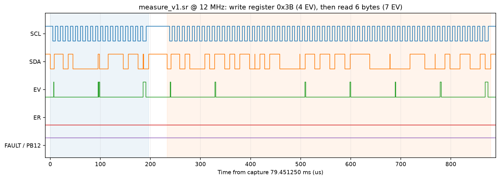
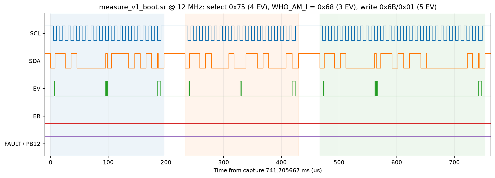
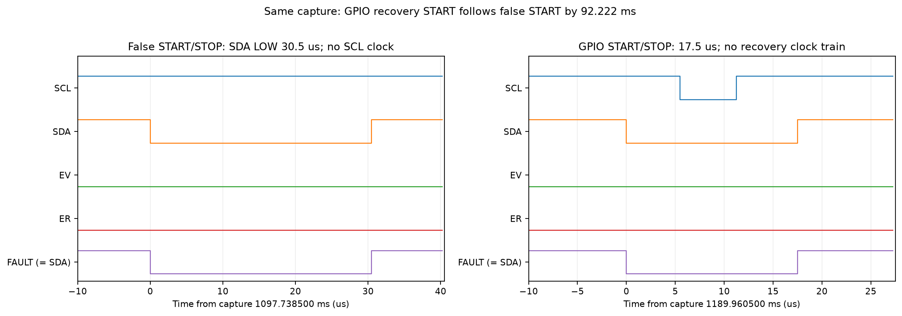
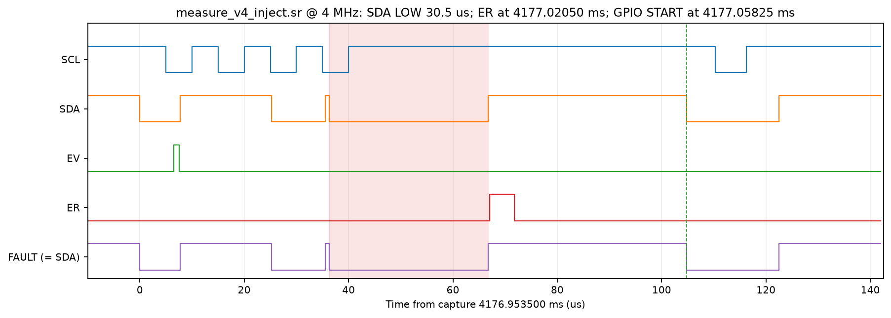

# W2.1 – Driver I2C1 bằng ngắt và bus recovery

MSSV **2452882**. Rà soát bằng chứng ngày **30/10/2026**.

## 1. Kết quả và phạm vi đã đo

Đã đo giao dịch MPU6050 bình thường, ngắt EV/ER, timeout và recovery sau xung lỗi SDA ngắn. Ba log có **38, 38 và 40 lần recovery liên tiếp được giao dịch OK kế tiếp xác nhận**, vượt yêu cầu 11 lần cho loại lỗi này.

**Chưa đủ bằng chứng cho trường hợp SDA bị slave giữ LOW và phải phát xung SCL để giải phóng:** mọi dòng recovery đều có `PULSES=0`. Vì vậy chưa kết luận đã kiểm chứng toàn bộ nhánh bus recovery trong đề. Phần đo bổ sung cần làm được ghi ở mục 7.

## 2. Cấu hình và cách thu dữ liệu

| Thành phần | Cấu hình |
|---|---|
| MCU / clock | STM32F103C8T6, HCLK 72 MHz, PCLK1 36 MHz |
| Bus | I2C1 PB6/SCL, PB7/SDA; 100 kHz; MPU6050 địa chỉ 7-bit `0x68` |
| Timeout / recovery target | 28 ms / 11 lần liên tiếp, theo `include/params.h` |
| Client | Hai task đọc ACCEL/GYRO; static mutex bảo vệ chuỗi chọn register rồi đọc dữ liệu |
| Hoàn tất giao dịch | ISR EV/ER báo task notification; task chờ bằng `ulTaskNotifyTake` |
| UART | USB-UART COM13 tại lượt đo đã lưu, 115200 8N1 |
| Logic analyzer | SCL, SDA, PB13/EV, PB14/ER, PB12/FAULT; 12 MHz hoặc 4 MHz |
| Chèn lỗi | PB12 open-drain nối SDA qua 220 Ω; xung đặt 30 µs, khoảng 1 lần/giây |

Firmware chèn lỗi dùng `W2E1_FAULT_INJECT=ON`, marker ISR dùng `W2E1_TRACE_EV=ON`. PB12 nối chung mạng SDA qua điện trở nên kênh FAULT bám theo SDA; kênh này không phải tín hiệu điều khiển chèn lỗi độc lập. Không dùng nó để suy ra mọi cạnh SDA đều là xung lỗi.

Danh sách file gốc và cách mở capture nằm trong [measurements/README.md](measurements/README.md). Các hình bên dưới được dựng trực tiếp từ sample trong `.sr`; mỗi sample tương ứng 0.0833 µs ở 12 MHz hoặc 0.25 µs ở 4 MHz.

## 3. Giao dịch và ngắt bình thường

| Giao dịch đã chọn | Capture; START (ms) | EV | Cạnh lên SCL | START → STOP (µs) |
|---|---|---:|---:|---:|
| Ghi register `0x3B` | `measure_v1.sr`; 79.451250 | 4 | 19 | 196.667 |
| Đọc 6 byte ACCEL | `measure_v1.sr`; 79.684417 | 7 | 64 | 646.583 |
| Chọn `WHO_AM_I`, ghi `0x75` | `measure_v1_boot.sr`; 741.705667 | 4 | 19 | 196.667 |
| Đọc `WHO_AM_I = 0x68` | `measure_v1_boot.sr`; 741.938833 | 3 | 19 | 196.667 |
| Ghi `PWR_MGMT_1`: `0x6B,0x01` | `measure_v1_boot.sr`; 742.172250 | 5 | 28 | 286.583 |

Số cạnh SCL ở đây tính cả cạnh lên khi tạo STOP; ví dụ địa chỉ + 1 byte dữ liệu có 18 clock truyền/ACK và 1 cạnh lên cho STOP. Số chữ số thập phân là kết quả đổi sample sang thời gian, không phải độ chính xác tuyệt đối của logic analyzer.

Trong transaction ghi 1 byte, bốn lần vào ISR tương ứng `SB` (EV5), `ADDR` (EV6), `TXE` (EV8) và `BTF` kết thúc truyền (EV8_2), đối chiếu FSM trong `i2c1_driver.c`. EV5 bắt đầu sau START khoảng 6.583 µs ở transaction đã chọn. Độ rộng marker EV trong cặp ghi/đọc này là **1.000–5.583 µs**, phụ thuộc nhánh xử lý; marker bao gồm thao tác GPIO đo.

Đọc 6 byte có 7 lần vào ISR trong cấu hình này: `SB`, `ADDR`, bốn lượt xử lý `BTF`, rồi `RXNE` cho byte cuối. Nhánh nhận dùng EV7/BTF; không gọi mọi ngắt RX là EV8. Số ngắt quan sát được phụ thuộc FSM và cờ có thể cùng xuất hiện, không phải số cố định cho mọi driver.

`measure_v1.sr` không có cạnh lên ER. Toàn bộ `measure_v1_boot.sr` có **một xung ER tại 417.853 ms**, nằm ngoài đoạn khởi tạo được chọn ở 741–743 ms. Capture không ghi SR1 tại xung đó nên chưa xác định nguyên nhân; không kết luận cả file boot hoàn toàn không có lỗi.

## 4. UART và số lần recovery liên tiếp

Parser chỉ đọc các hàng đủ 13 cột sau banner của firmware hiện hành. Với log baseline, bỏ phần dữ liệu firmware cũ trước banner, không sửa dòng cũ để tính PASS.

| Log gốc | Banner | Dòng OK | Dòng RECOVERED | RECOVERED → OK tăng streak | Streak lớn nhất |
|---|---:|---:|---:|---:|---:|
| [baseline](measurements/w2e1_baseline.log.txt) | 1 | 164 | 0 | 0 | 0 |
| [inject_la](measurements/w2e1_inject_la.log.txt) | 1 | 981 | 38 | 38 | 38 |
| [inject_la2](measurements/w2e1_inject_la2.log.txt) | 1 | 1000 | 38 | 38 | 38 |
| [inject_la4](measurements/w2e1_inject_la4.log.txt) | 1 | 1042 | 40 | 40 | 40 |

`OK` gồm dòng INIT thành công. Ba log chèn lỗi không có status khác ngoài `OK` và `RECOVERED`. `RECOVERED` chỉ báo routine recovery thành công; ứng dụng chỉ tăng streak sau giao dịch `OK` kế tiếp. Không thấy banner khởi động lặp hoặc streak bị xóa trong ba đoạn log, phù hợp với phục hồi mà không reset MCU trong các lượt đã thu.

Trong `inject_la4`, thời gian cột `US` của 40 lượt RECOVERED phân bố như sau:

| US (µs) | 153 | 253 | 387 | 427 | 28050 |
|---|---:|---:|---:|---:|---:|
| Số lượt | 5 | 2 | 2 | 5 | 26 |

Có 14 lượt nhanh 153–427 µs và 26 lượt chờ timeout 28.050 ms. `PULSES` bằng 0 trong cả 40 lượt và trong hai log chèn lỗi còn lại.

## 5. Dạng sóng recovery

Trong `measure_v4_inject.sr` (4 MHz, 5 s), ba xung SDA ngắn xảy ra khi SCL HIGH; không có clock truyền trong xung. Xung còn lại làm gián đoạn transaction sau bốn cạnh lên SCL.

| Mốc SDA LOW nhận diện trên capture (ms) | GPIO recovery START (ms) | Chênh lệch (ms) | STOP của lần đọc 6 byte hoàn chỉnh kế tiếp (ms) | SDA LOW → lần đọc đó hoàn tất (ms) |
|---:|---:|---:|---:|---:|
| 1097.73850 | 1189.96050 | 92.222 | 1197.83875 | 100.100 |
| 2120.82675 | 2151.95850 | 31.132 | 2220.83675 | 100.010 |
| 3150.93250 | 3209.95650 | 59.024 | 3250.83500 | 99.903 |
| 4176.98975 | 4177.05825 | 0.06850 | 4240.83325 | 63.843 |

Cột cuối là thời gian trên bus tới STOP của frame đọc 6 byte kế tiếp (7 EV, 64 cạnh lên SCL), không phải timestamp của dòng UART `OK`. UART không có timestamp tuyệt đối để ghép từng dòng với từng frame.

Các xung SDA LOW nhận diện có độ rộng **30.5 µs**. Ca nhanh có SDA nhả tại **4177.02025 ms**, ER lên tại **4177.02050 ms** (cách 0.25 µs), GPIO START tại **4177.05825 ms**, và STOP tại **4177.07600 ms**. Vùng START/STOP GPIO dài **17.75 µs**. Khoảng 30.5 µs chèn lỗi nằm trong critical section của fault task, nên không diễn giải ER là phản hồi sau 0.25 µs kể từ lúc bắt đầu xung lỗi.

Trong ba ca chậm, xung tạo START/STOP giả trên bus; routine recovery chạy khi client kế tiếp gặp bus không rảnh rồi hết timeout. Đây là cách giải thích phù hợp với dạng sóng và source; capture không ghi trực tiếp cờ BUSY. Một cạnh SCL lên trong chuỗi START/STOP GPIO không phải chuỗi clock của vòng `i2c1_recovery_pulses()`.

## 6. Đối chiếu PREDICTION và sai số

| Dự đoán trước đo | Kết quả | Nhận xét |
|---|---|---|
| Ghi N byte: khoảng N+3 ngắt EV | N=1: 4; N=2: 5 | Khớp các transaction được chọn |
| START → EV5 vài µs | 6.583 µs ở transaction mẫu | Gồm thời gian phần cứng tạo START; không phải latency CPU thuần |
| Đủ 11 recovery liên tiếp nếu lỗi được gỡ | 38 / 38 / 40, mỗi recovery có OK xác nhận | Đạt với xung lỗi ngắn đã đo |
| Gỡ SDA bằng tối đa 9 xung SCL | PULSES=0 trong mọi log | Chưa kiểm chứng nhánh phát clock |
| Phát hiện lỗi → transaction kế tiếp OK khoảng 1–5 ms nếu task được chạy ngay | Không có timestamp đúng mốc phát hiện lỗi; lần đọc kế tiếp trên bus cách xung lỗi 63.843–100.100 ms | Chưa kiểm chứng đúng metric dự đoán; không gán PASS từ một ca GPIO recovery nhanh |

Cặp ghi/đọc mẫu trên bus kéo dài **879.750 µs**, gồm 196.667 µs ghi, 36.500 µs khoảng cách và 646.583 µs đọc. UART của cấu hình có marker thường in khoảng **917 µs** cho một lượt client. Chênh lệch đối chiếu khoảng **37.250 µs**, có thể bao gồm lời gọi driver, mutex và xử lý phần mềm; hai nguồn chưa được ghép timestamp cùng transaction nên chưa phân bổ riêng chi phí từng thành phần.

`US=28050` phù hợp với timeout 28 ms cộng khoảng 50 µs trong đường xử lý. Thời gian từ xung lỗi đến recovery còn phụ thuộc lúc client bắt đầu gọi driver; thời gian đến giao dịch kế tiếp còn chịu chu kỳ client. Không dùng `US` để thay cho cả hai đại lượng đó.

## 7. Phần còn thiếu và giải thích thiết kế

**Cần đo bổ sung SDA-stuck:** tạo tình huống SDA còn LOW lúc routine recovery bắt đầu, quan sát được 1–9 xung SCL thực sự, SDA nhả và STOP trước một giao dịch thành công. Lặp đến ít nhất 11 recovery liên tiếp được OK xác nhận, có log `PULSES>0` và capture đồng bộ. Nếu SDA tiếp tục bị ngoại vi giữ LOW sau 9 xung, driver phải báo thất bại thay vì ghi recovery thành công. Bộ log hiện tại chưa chứng minh các trường hợp này.

Routine giữ mutex bus, tắt IRQ/I2C, chuyển PB6/PB7 sang GPIO open-drain, chỉ phát clock khi SDA chưa nhả, tạo START/STOP, trả chân về AF và cấu hình lại I2C. STOP là SDA LOW→HIGH khi SCL HIGH; nó kết thúc trạng thái truyền trên bus. Nhánh recovery ở source đã có, nhưng source không thay thế bằng chứng đo nhánh phát clock. Chưa làm phép thử bỏ STOP, nên tác động của việc bỏ STOP mới là lập luận thiết kế.

Kiểm tra source ngày 30/10/2026: `tools/check_api.sh week2/ex1 week2/ex2 week2/ex3` **PASS (14 files)**. Build hiện tại và phạm vi kiểm chứng được ghi trong [validation.md](../ex3/measurements/validation.md). Build không bổ sung bằng chứng SDA-stuck còn thiếu.
