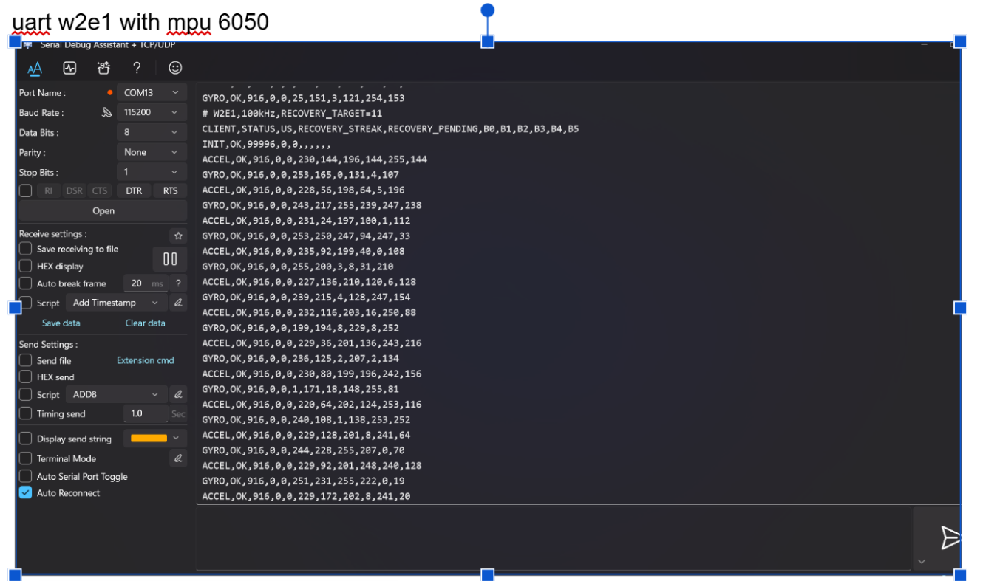

# W2.1 – Bằng chứng UART với MPU6050

Ảnh do người thực hiện cung cấp, hiển thị UART COM13 ở 115200 baud, 8N1. Có dòng `INIT,OK,99996,0,0,...` và các dòng `ACCEL,OK`, `GYRO,OK`; trường thời gian của các mẫu hiển thị là 916 µs.

Ảnh cập nhật này xác nhận lượt khởi tạo và đọc dữ liệu thông thường đã thành công, sau lượt `INIT,BUS` được mô tả trong báo cáo trước đó. Các byte dữ liệu được hiển thị ở dạng thô; ảnh không đủ để đánh giá độ chính xác hay hiệu chuẩn cảm biến.

`RECOVERY_STREAK` và `RECOVERY_PENDING` trong ảnh đều bằng 0. Ảnh chưa chứng minh phục hồi bus 11 lần liên tiếp, số xung SCL hay dạng sóng recovery; các phần đó vẫn cần bằng chứng riêng.
