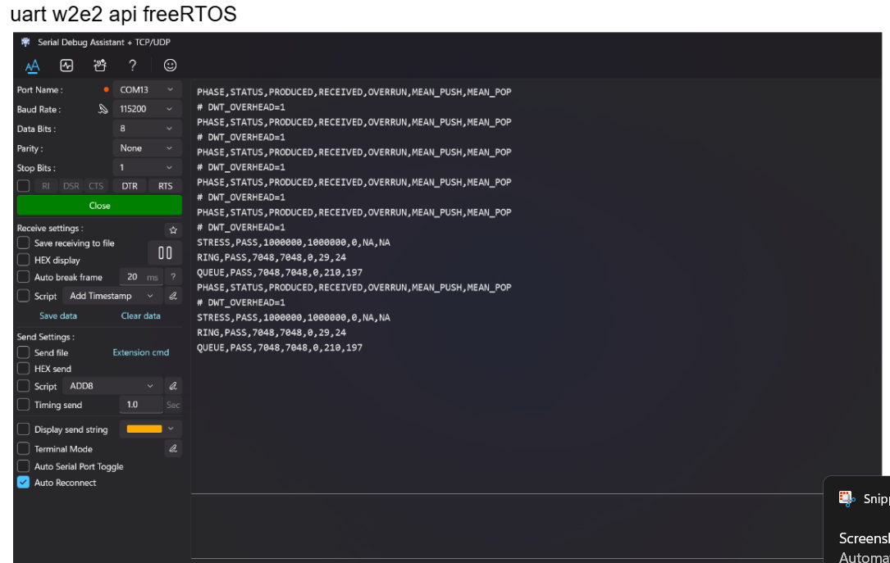

# W2.2 – Bằng chứng UART Stress Test và Benchmark



Ảnh do người thực hiện cung cấp, hiển thị hai lượt kết quả hoàn chỉnh có cùng số liệu. Nội dung dưới đây được chép lại từ ảnh, không phải file CSV xuất trực tiếp từ UART.

```text
# DWT_OVERHEAD=1
STRESS,PASS,1000000,1000000,0,NA,NA
RING,PASS,7048,7048,0,29,24
QUEUE,PASS,7048,7048,0,210,197
```

Stress Test ghi nhận 1.000.000 phần tử được tạo và nhận, trạng thái PASS, overrun bằng 0. Ring và Queue đều hoàn thành 7.048 mẫu benchmark với overrun bằng 0.

Các giá trị trung bình push/pop của Ring là 29/24 cycle; send/receive của Queue là 210/197 cycle. Tổng theo số nguyên hiển thị lần lượt là 53 và 407 cycle/cặp, tỷ lệ Queue/Ring khoảng 7,68. Đây là kết quả trong cấu hình thử nghiệm của bài, không phải giới hạn thời gian cho mọi tình huống.
