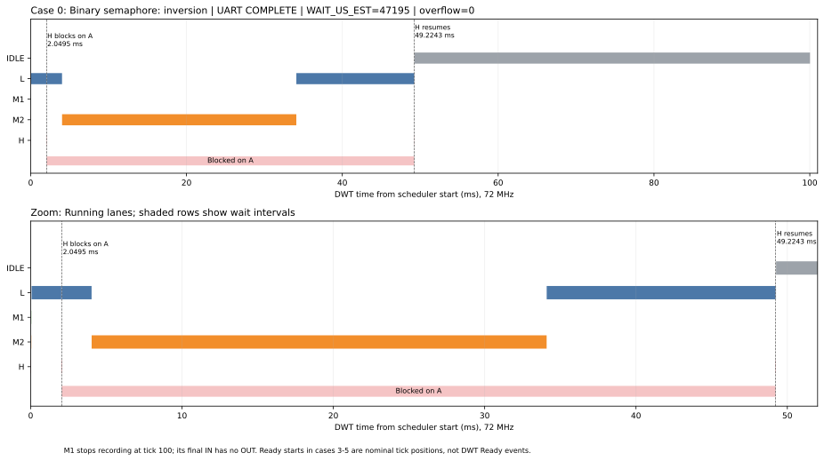
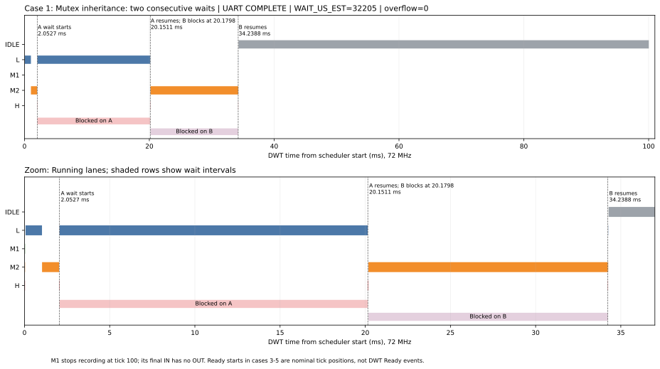
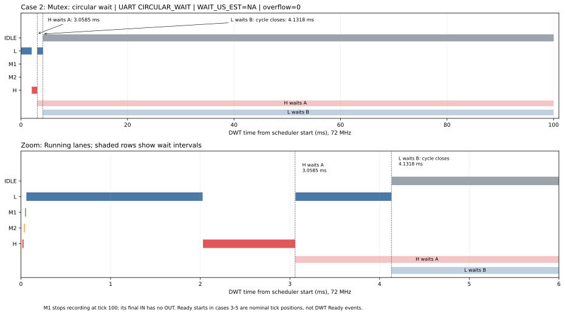
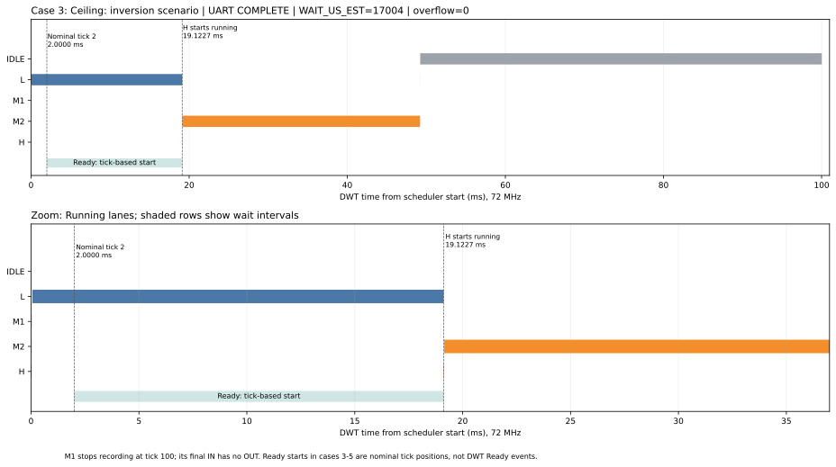
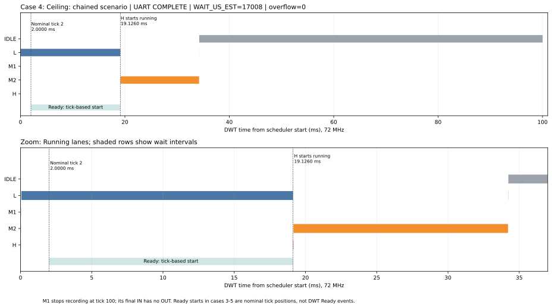
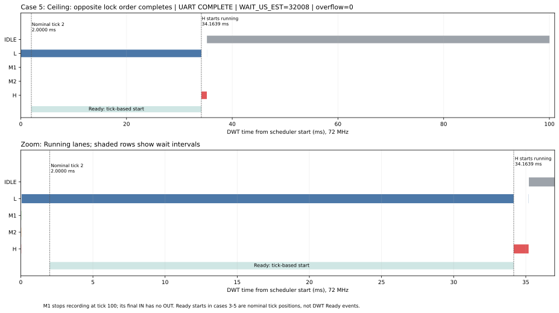

# W2.3 – Inversion, chained blocking, deadlock và priority ceiling

MSSV **2452882**. Đo và rà hồ sơ ngày **30/10/2026**.

## 1. Kết quả và cấu hình

Đã có UART log và trace cho đủ **6 case**. Case 0/1 thể hiện inversion và hai lần chờ nối tiếp; case 2 có circular wait; case 3/4/5 hoàn tất khi dùng ceiling. Mọi block được chọn đều có `overflow=0`, số dòng trace bằng `# RECORDS`, có `# END`.

| Thành phần | Cấu hình |
|---|---|
| MCU / clock / build | STM32F103C8T6, 72 MHz, `-O2`, CMake/Ninja |
| Priority cơ sở | L=2, M1=3, M2=5, H=7 |
| Vùng găng | A=19 ms CPU; B=15 ms CPU |
| Scheduler | Tick 1 ms, preemption bật, time slicing tắt |
| Kích hoạt | H tại tick 2; M2 tại tick 4 (inversion) hoặc tick 1 (chained); M1 báo cáo ở tick 100 |
| Ceiling | A=7, B=7; static mutex, raw FreeRTOS API |
| Thu log | CP210x COM19, 115200 8N1, Serial Debug Assistant mở trước flash/reset |
| Tag / GPIO tracer | 0=IDLE/PA4, 1=L/PA5, 2=M1/PA6, 3=M2/PA7, 4=H/PA8 |

Code: [blocking_app.c](blocking_app.c), [priority_ceiling.c](priority_ceiling.c), [priority_ceiling.h](include/priority_ceiling.h). Tham số MSSV nằm trong `include/params.h` được sinh bởi `tools/gen_params.py`.

## 2. Dữ liệu gốc và cách đọc

| Case | Log gốc | Block hoàn chỉnh trong file | Trace được chọn |
|---:|---|---:|---:|
| 0 | [case0.log](measurements/case0.log) | 5 | 23 records |
| 1 | [case1.log.txt](measurements/case1.log.txt) | 5 | 27 records |
| 2 | [case2.log.txt](measurements/case2.log.txt) | 5 | 15 records |
| 3 | [case3.log.txt](measurements/case3.log.txt) | 5 | 17 records |
| 4 | [case4.log.txt](measurements/case4.log.txt) | 5 | 19 records |
| 5 | [case5.log.txt](measurements/case5.log.txt) | 4 | 15 records |

Các block trong từng file có cùng số đo. Báo cáo dùng **block hoàn chỉnh đầu tiên** của mỗi case; không coi số block lặp là số phép đo độc lập đã kiểm soát. Không ghép các trace reset cùng mốc CYCCNT vào một Gantt. Dữ liệu đã tách và bảng CSV ở [measurements/README.md](measurements/README.md).

`TAKE_A_US/TAKE_B_US` đo DWT từ trước đến sau lời gọi lấy khóa, gồm thời gian Blocked và overhead API. `READY_TICKS` đo mức trễ khi H chạy sau mốc release tick 2. `WAIT_US_EST = READY_TICKS × 1000 + thời gian hai lời gọi take quy đổi từ tổng cycle` khi H hoàn tất; `NA` nghĩa là thao tác chưa hoàn tất hoặc không được thực hiện. Sai khác một đơn vị do làm tròn từng cột có thể có, vì tổng cycle được đổi đơn vị riêng.

## 3. Bảng số đo

| Case / cơ chế | H_DONE | READY_TICKS | TAKE_A (µs) | TAKE_B (µs) | WAIT_US_EST (ms) | Trạng thái |
|---|---:|---:|---:|---:|---:|---|
| 0 — binary semaphore | 1 | 0 | 47195 | NA | **47.195** | COMPLETE |
| 1 — mutex inheritance | 1 | 0 | 18122 | 14083 | **32.205** | COMPLETE |
| 2 — mutex khóa chéo | 0 | 0 | NA | 2 | NA | **CIRCULAR_WAIT** |
| 3 — ceiling inversion | 1 | 17 | 4 | NA | **17.004** | COMPLETE |
| 4 — ceiling chained | 1 | 17 | 4 | 4 | **17.008** | COMPLETE |
| 5 — ceiling khóa chéo | 1 | 32 | 4 | 4 | **32.008** | COMPLETE |

| Cơ chế | H thực sự vào Blocked trên khóa | Chờ Ready do ceiling | Khoảng chờ báo cáo |
|---|---|---|---|
| Binary semaphore (case 0) | 1 lần: A | Không trễ tick quan sát được | 47.195 ms gồm overhead take |
| Mutex inheritance (case 1) | 2 lần: A rồi B | Không trễ tick quan sát được | 18.122 + 14.083 = 32.205 ms |
| Ceiling không lồng (case 3/4) | Không thấy lần Blocked dài trong trace | 17 ticks | Ước lượng 17.004 / 17.008 ms |
| Ceiling với vùng găng lồng (case 5) | Không thấy lần Blocked dài trong trace | 32 ticks | Ước lượng 32.008 ms |

Các lời gọi take 4 µs là đường thực thi ngắn, không phải bằng chứng H không phải chờ CPU. Với ceiling, phần chờ chính diễn ra khi H đã Ready nhưng L đang chạy ở effective priority 7.

## 4. Gantt và các điểm cần chỉ ra

Gantt gốc được tạo bằng `tools/trace_gantt.py` từ `.trace.csv`. Các hình dưới thêm tên task, trục DWT ms, vùng chờ và cửa sổ phóng to. Lane task biểu diễn **Running**, không biểu diễn trực tiếp Ready/Blocked. Vùng chờ kết hợp trace với source và status UART.

### Case 0 — inversion không inheritance

H yêu cầu A khoảng tick 2 rồi Blocked. M2 không dùng A nhưng chạy khoảng 30 ms trước khi L hoàn thành A. H chờ 47.195 ms, dài hơn riêng phần công việc còn lại của L. Thử nghiệm hữu hạn này chứng minh cơ chế inversion; tính unbounded được suy ra khi workload trung gian có thể tiếp tục tăng, không phải đã đo một khoảng chờ vô hạn.

### Case 1 — chained blocking dù có inheritance

| Điểm trên trace | Cycle | DWT ms |
|---|---:|---:|
| H OUT khi chờ A | 147792 | 2.052667 |
| H IN sau khi L nhả A | 1450879 | 20.151097 |
| H OUT tiếp theo khi chờ B | 1452947 | 20.179819 |
| H IN sau khi M2 nhả B | 2465197 | 34.238847 |

Hai đoạn H không được chạy là khoảng **18.098431 ms** và **14.059028 ms** (OUT→IN). Chúng ngắn hơn số đo quanh take 18.122/14.083 ms vì không gồm các lệnh H chạy trước khi Blocked và sau khi được đánh thức. L kế thừa priority để nhả A, rồi M2 kế thừa priority để nhả B: có hai owner khác nhau chặn H nối tiếp, không nhầm với một owner bị M2 chiếm CPU như case 0.

### Case 2 — circular wait

H đã lấy B (`TAKE_B_US=2`), sau đó OUT tại **220209 cycle = 3.058458 ms** khi chờ A. L OUT tại **297489 cycle = 4.131792 ms** khi chờ B. Từ mốc sau, vòng chờ là `L giữ A → chờ B → H giữ B → chờ A`. UART tại tick 100 ghi `H_DONE=0, L_WAIT_B=1, H_PENDING=0(A)` và `CIRCULAR_WAIT`.

Idle tiếp tục chạy; MCU không bị treo toàn hệ thống. Capture quan sát tới khoảng 100 ms; kết luận deadlock không tự thoát dựa thêm vào hai take dùng `portMAX_DELAY`, không timeout/đường nhả khóa khác. Không ghi `NA` thành 0 ms hoặc lấy cửa sổ quan sát 100 ms làm thời gian chờ hữu hạn.

### Case 3/4 — ceiling ngăn task trung gian chen vào

H được release ở tick 2 nhưng chỉ chạy sau khi L nhả A. Trong case 4, M2 chưa thể chen vào giữ B trước H, nên không tái hiện chuỗi chờ B 14 ms của case 1. Đầu vùng Ready trên hình ở 2 ms là **mốc tick danh định**, không phải sự kiện Ready được timestamp DWT.

### Case 5 — cùng khóa chéo, không còn deadlock trong cấu hình này

Thứ tự yêu cầu vẫn là L: A→B và H: B→A. L chạy vùng găng ngoài khoảng 34 ms, bao gồm workload A+B, rồi H lấy B/A và hoàn tất. `L_WAIT_B=0`, `H_PENDING=2(NONE)`, `H_DONE=1`. H chờ 32 ticks Ready rồi có hai take ngắn 4 µs. Công việc riêng 1 ms của H sau khi lấy B không được cộng vào `WAIT_US_EST`.

Mọi trace kết thúc với M1/tag 2 đang IN vì M1 gọi `tracer_stop()` trước khi dump UART; renderer báo đúng một unmatched IN cuối. Không chèn một OUT giả vào dữ liệu; đây là ranh giới dừng capture, không phải lỗi mất các đoạn chờ trước đó.

## 5. Đối chiếu dự đoán và sai số

| Case | Dự đoán | Kết quả | Đối chiếu |
|---:|---|---|---|
| 0 | Khoảng 47 ms | 47.195 ms | +195 µs, khoảng +0.415% |
| 1 | A≈18 ms, B≈14 ms; tổng≈32 ms | 18.122 + 14.083 = 32.205 ms | +122 / +83 µs; tổng +205 µs, khoảng +0.641% |
| 2 | Vòng chờ hình thành≈4 ms | L OUT cuối tại 4.131792 ms; status circular wait | Khớp cơ chế; không có thời gian chờ hữu hạn |
| 3/4 | Ready≈17 ms | 17 ticks; tổng ước lượng 17.004 / 17.008 ms | Khớp ở mức tick; không kết luận sai số chỉ 4/8 µs |
| 5 | Vùng găng lồng≈34 ms; H chờ≈32 ms | 32 ticks; tổng ước lượng 32.008 ms | Khớp ở mức tick; không áp dụng giới hạn 19 ms cho vùng găng lồng |

[W1.2 REPORT](../../week1/ex2/REPORT.md) ghi OUT→IN ở `-O2` từ **219 đến 244 cycle**, jitter **25 cycle = 0.347 µs**. Từ chính trace W2.3 đã chọn:

| Case | OUT→IN min–max (cycle) | Jitter (cycle) | Jitter (µs) |
|---:|---:|---:|---:|
| 0 | 244–313 | 69 | 0.958 |
| 1 | 244–288 | 44 | 0.611 |
| 2 | 244–336 | 92 | 1.278 |
| 3 | 244–288 | 44 | 0.611 |
| 4 | 240–285 | 45 | 0.625 |
| 5 | 246–307 | 61 | 0.847 |

Đây là khoảng giữa hook OUT và hook IN, không phải toàn bộ chi phí chuyển ngữ cảnh hoặc giới hạn cho mọi đường kernel. Tập task và nhánh kernel khác W1.2 nên số có thể khác. Jitter W1.2 0.347 µs nhỏ hơn sai lệch 195/205 µs hàng trăm lần; không dùng nó để giải thích toàn bộ phần chênh.

Tổng gap OUT→IN trong khoảng H không được chạy ở case 0 là **1128 cycle = 15.667 µs**, case 1 là **1054 cycle = 14.639 µs** (cộng hai khoảng chờ). Các gap này là một phần thời gian đo, không phải toàn bộ phần tăng so với mô hình lý tưởng. Workload `work_ms()` được hiệu chuẩn từ vòng 10,000 lượt lúc tắt IRQ, nhưng chạy thử có SysTick, wrapper vòng lặp và các đường API/tracer khác nhau; start task cũng lệch mốc 0 lý tưởng. Chưa có phép đo tách riêng từng thành phần để phân bổ chính xác +195/+205 µs.

`READY_TICKS` có bước 1 ms, CYCCNT không ghi trực tiếp thời điểm chuyển sang Ready. Vì vậy các tổng ceiling là ước lượng trộn độ phân giải; các chữ số µs cuối không làm phần Ready có độ chính xác µs.

## 6. Vì sao ceiling tránh deadlock ở đây và giới hạn wrapper

Wrapper nâng priority lên ceiling **trước khi take**, lưu priority cũ sau khi take thành công; lúc unlock, give mutex trước rồi hạ priority. Thứ tự này được mô tả đồng nhất trong `priority_ceiling.c` và header.

Với cả A/B có ceiling 7, L không self-suspend/yield khi giữ khóa, và time slicing tắt, task H cùng effective priority 7 không chạy chen để giữ B trong lúc L giữ A. L lấy được B, nhả B rồi A; sau đó H mới lấy B→A. Circular wait vì thế không hình thành. Inheritance ở case 2 chỉ nâng priority owner, không buộc owner nhả khóa nên không tự phá vòng chờ.

Chứng minh trên gắn với cấu hình đã đo: mọi truy cập đi qua wrapper, ceiling bao phủ priority của người dùng, không delay/yield/notification-wait khi giữ khóa, không lấy lại cùng mutex thường và unlock lồng theo LIFO. Nếu đổi các điều kiện đó, phải phân tích lại; chỉ thấy case 5 COMPLETE không chứng minh wrapper đúng cho mọi cấu hình.

Mỗi mutex lưu một `saved_prio`, không có bảng ceiling toàn hệ thống hay kiểm tra thứ tự tài nguyên. Không mô tả wrapper như có một luật admission chưa được code thực hiện. Việc chặn interleaving ở đây đến từ nâng priority ngay và các điều kiện lập lịch trên. Đổi lock order thống nhất A→B là một cách khác để loại circular wait, nhưng lượt đo hiện tại kiểm tra giải pháp ceiling với thứ tự chéo giữ nguyên.

## 7. Stack và kiểm tra hồ sơ

Task L/M1/M2/H có stack 256 words. High-water mark là lượng stack còn trống ít nhất, không phải lượng đã dùng:

| Case | L | M1 | M2 | H | Đơn vị |
|---:|---:|---:|---:|---:|---|
| 0 | 224 | 224 | 230 | 224 | words |
| 1 | 224 | 224 | 222 | 218 | words |
| 2 | 226 | 224 | 232 | 218 | words |
| 3 | 232 | 224 | 230 | 230 | words |
| 4 | 232 | 224 | 230 | 230 | words |
| 5 | 232 | 224 | 232 | 228 | words |

M1 được đọc HWM trước khi dump toàn bộ trace nên giá trị chưa bao phủ mọi lệnh dump về sau; không dùng bảng này để chứng minh stack đủ cho mọi workload.

PREDICTION đã có commit `e5c3234` ngày 23/10/2026 trước lượt đo trong phiên này. Raw log không có commit hash của firmware; liên hệ source/case dựa trên header, layout log và quy trình build/flash đã thực hiện. Kiểm tra build/API ngày 30/10/2026 ghi trong [validation.md](measurements/validation.md); không coi build lại là một lần chạy board mới.
