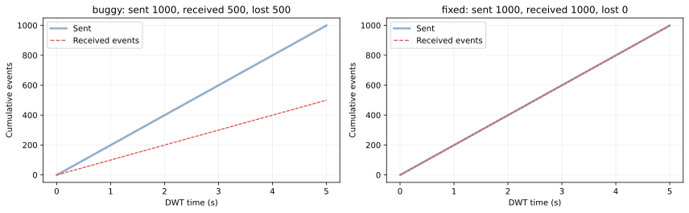
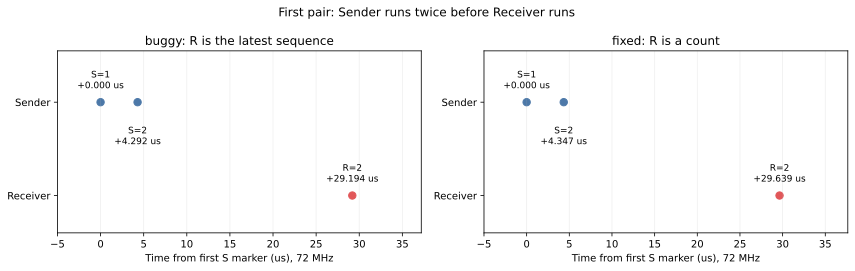

# W2.4 – Event group, barrier và task notification

MSSV **2452882**. Rà log và kiểm tra source ngày **30/10/2026**.

## 1. Kết quả và cấu hình

Hai lượt đo có đủ log UART tới `# END`, barrier PASS và trace sự kiện không bị tràn. Đếm lại từng record xác nhận bản buggy gửi **1000**, nhận **500**, mất **500 sự kiện**; bản fixed gửi **1000**, nhận cộng dồn **1000**, không mất sự kiện trong lượt đã chạy.

| Thành phần | Cấu hình |
|---|---|
| MCU / clock / optimization | STM32F103C8T6, 72 MHz, `-O2` |
| Barrier | 3 task, bits riêng `0x01/0x02/0x04`, chờ mask `0x07`, timeout 101 ms |
| Task priority | Sender=3, Receiver=2, Logger=1; Idle=0; time slicing tắt |
| Mốc vào barrier | Sender gần tick 1, Receiver tick 2, Logger tick 3 |
| Bắt đầu gửi | Từ tick 10; Sender gửi 2 lần rồi delay tới cặp kế tiếp |
| Tải | 500 cặp, chu kỳ cặp 10 ms, tổng 1000 notification |
| Biến thể | `w2e4`: USE_FIXED=0; `w2e4_fixed`: USE_FIXED=1 |
| Các option đã đo | BURST_PERIOD_MS=10, BARRIER_LATE_MS=0 |
| Thu log | Serial Debug Assistant, UART 115200 8N1, mở trước khi flash/reset |
| Benchmark | 1000 cặp mỗi cơ chế, DWT; hiệu chỉnh overhead 1 cycle |

Code: [sync_app.c](sync_app.c), [sync_app.h](include/sync_app.h), [FreeRTOSConfig.h](include/FreeRTOSConfig.h). Tham số MSSV lấy từ `include/params.h` do `tools/gen_params.py` sinh.

## 2. Bằng chứng và kiểm tra trace

| Lượt | Log gốc | Record S | Record R | Tổng record sự kiện | TRACE_DROPPED | STATUS |
|---|---|---:|---:|---:|---:|---|
| Buggy | [buggy.log.txt](measurements/buggy.log.txt) | 1000 | 500 | 1500 | 0 | LOSS_CONFIRMED |
| Fixed | [fixed.log.txt](measurements/fixed.log.txt) | 1000 | 500 | 1500 | 0 | BALANCED |

Mỗi file có đúng một banner biến thể và một `# END`. Kiểm tra lại toàn bộ trace: S có sequence đúng `1…1000`, timestamp tăng, 500 nhóm đều theo thứ tự **S, S, R**. Bản buggy trả lần lượt `2,4,…,1000`; bản fixed trả count **2** trong cả 500 lần nhận. Các số này khớp counter cuối của firmware, không chỉ dựa vào dòng STATUS.

Marker `S` được ghi **trước** lời gọi `xTaskNotify`; marker `R` được ghi **sau** `xTaskNotifyWait` và cập nhật counter. Khoảng marker vì vậy gồm cả instrumentation, lời gọi API và lịch task; không coi là latency riêng của kernel.

Có hai bộ trace riêng. `# EV` theo dõi toàn bộ gửi/nhận đến khoảng **5.000054 s**, không mất record. Tracer chuyển task W1.2 chỉ giữ **254 record IN/OUT**, dừng sau OUT ở khoảng **0.290050 s** khi buffer gần đầy. `overflow=0` không có nghĩa Gantt bao phủ đủ 5 giây; source chủ động dừng trước tràn. Dữ liệu Gantt được ghép IN/OUT đầy đủ, không có anomaly.

Gantt đoạn đầu: [buggy](measurements/buggy.gantt.svg), [fixed](measurements/fixed.gantt.svg). Chứng minh số sự kiện cho toàn lượt dựa vào 1500 record EV mỗi file, không ngoại suy từ Gantt đoạn đầu. Script, CSV và dữ liệu kiểm toán nằm trong [measurements/README.md](measurements/README.md).

## 3. Barrier

Mỗi task gọi `xEventGroupSync(group, 1UL << idx, 0x07, 101 ms)`. Khi đủ mask, barrier hoàn tất và các task lần lượt trở về theo scheduler. Trước phần gửi/nhận, source kiểm tra snapshot trả về của cả ba task đều có đủ `0x07`; hai lượt đều ghi `BARRIER=PASS`.

| Lượt | BARRIER_RELEASE_CYCLES | Ở 72 MHz (µs) | Dự đoán (cycle) | Vượt cận trên dự đoán |
|---|---:|---:|---|---|
| Buggy | 3566 | 49.528 | 500–3000 | +566 cycle, +18.87% |
| Fixed | 3600 | 50.000 | 500–3000 | +600 cycle, +20.00% |

Metric là `max(barrier_out) − max(barrier_in)`: từ marker trước lời gọi của participant đến cuối cùng tới marker sau lời gọi cuối cùng trở về. Nó gồm chi phí event group, chuyển task, tracer và các lệnh quanh API; không phải thời gian ba task chạy đồng thời hoặc chỉ chi phí đặt một bit. Capture Gantt fixed cho thấy Logger chạy, rồi Sender, Receiver và Logger tiếp tục quanh mốc 3 ms. Chưa đo tách các thành phần để phân bổ chính xác 566/600 cycle vượt dự đoán.

Hai lượt có BARRIER_LATE_MS=0. Timeout 101 ms có trong cấu hình/source nhưng **chưa có log thử ép timeout**; không ghi BARRIER=FAIL là đã được kiểm chứng trên board.

## 4. Phát hiện bug bằng số đo

| Biến thể | Số lần gửi | Số lần `xTaskNotifyWait` nhận thành công | Số sự kiện nhận cộng dồn | Mất |
|---|---:|---:|---:|---:|
| `eSetValueWithOverwrite` | 1000 | 500 | 500 | **500 (50%)** |
| `eIncrement` + cộng count | 1000 | 500 | 1000 | **0** |

Không cộng các sequence payload của bản buggy để đếm sự kiện: tổng `2+4+…+1000=250500` không có nghĩa đã nhận 250500 sự kiện. Mỗi lần nhận buggy chỉ chứng minh một notification được tiêu thụ. Bản fixed trả count nên cần cộng các giá trị 2 để có 1000 sự kiện; số lần gọi receive vẫn là 500.

Nhóm đầu tiên trong dữ liệu gốc:

| Lượt | S(sequence=1), cycle | S(sequence=2), cycle | R(value=2), cycle | S1→S2 (µs) | S2→R (µs) |
|---|---:|---:|---:|---:|---:|
| Buggy | 722702 | 723011 | 724804 | 4.292 | 24.903 |
| Fixed | 722687 | 723000 | 724821 | 4.347 | 25.292 |

Sender có priority cao hơn Receiver. Lần gửi đầu đặt notification pending; lần gửi sau xảy ra trước khi Receiver được chạy. Với overwrite, slot chỉ còn sequence 2; pending state không trở thành hàng đợi hai phần tử. Khi Sender delay, Receiver mới chạy và nhận 2. Trace lặp lại đúng mô hình này trong cả 500 cặp; các sequence lẻ không xuất hiện trong R.

| Thông số marker, tính lại từ toàn bộ EV | Buggy | Fixed |
|---|---:|---:|
| Khoảng giữa đầu hai cặp liên tiếp, median | 10.000000 ms | 10.000000 ms |
| Khoảng đó, min–max | 9.995833–10.000278 ms | 9.995861–10.000264 ms |
| S1→S2 trong một cặp, median | 390 cycle = 5.417 µs | 395 cycle = 5.486 µs |
| S2→R trong một cặp, median | 1107 cycle = 15.375 µs | 1130 cycle = 15.694 µs |

Tải danh định là 100 cặp/giây, tương đương 200 lần gửi/giây; mỗi cặp hai lần gửi cách nhau chỉ khoảng 5.4–5.5 µs ở median. Tổng số lần gửi nhỏ hơn năng lực CPU trung bình không ngăn mất sự kiện: chính khoảng burst và thứ tự ưu tiên khiến Receiver không tiêu thụ giữa hai lần gửi. Dự đoán mất 500/1000 khớp số đo, không cần gọi chung chung là race condition.

## 5. Vì sao bản fixed bảo toàn số sự kiện

Sender gọi `xTaskNotify(receiver, 0, eIncrement)`. Giá trị notification tăng từ 0 lên 1 rồi 2 trước khi Receiver chạy. Receiver dùng `xTaskNotifyWait(0, UINT32_MAX, &count, portMAX_DELAY)` và cộng `count` vào tổng. Clear-on-entry bằng 0; đọc và clear-on-exit do API xử lý trong critical section của kernel. Notification mới đến sau khi slot đã được drain thuộc lần nhận tiếp theo.

Đo thực tế xác nhận 500 lần R đều có count=2, tổng 1000 bằng 1000 S. Điều này bảo toàn **số lần xảy ra sự kiện** trong kịch bản đã đo. Sequence ở S chỉ là dữ liệu debug trong trace; API eIncrement không chuyển từng payload đó tới Receiver.

Không khẳng định đúng cho mọi tốc độ vô hạn: counter notification 32 bit có thể wrap khi tồn đọng quá nhiều, tổng nhận của ứng dụng cũng có giới hạn, task có thể không xử lý kịp, và không được có chỗ khác xóa cùng notification slot. Dùng `eSetBits` nhiều lần với cùng một bit cũng gộp các lần xuất hiện, không thay được bộ đếm khi cần giữ số lần. Nếu cần giữ payload riêng, cần Queue/ring và chính sách xử lý đầy phù hợp.

## 6. RAM và cycle trước–sau

So sánh chính dùng hai đường benchmark trong **cùng firmware fixed**, cùng Logger, 1000 mẫu mỗi đường:

| Cơ chế | RAM đối tượng đồng bộ + 4 TCB (B) | Cycle trung bình / cặp | Thời gian / cặp ở 72 MHz (µs) |
|---|---:|---:|---:|
| Binary semaphore: give + take | 460 | **303** | 4.208 |
| Fixed notification: notify + wait | 380 | **581** | 8.069 |

Một mẫu là cả cặp báo hiệu–nhận, không phải chỉ một lệnh send. Notification dùng ít hơn **80 B (17.39%)** theo phạm vi đối tượng này nhưng tốn thêm **278 cycle = 3.861 µs**, khoảng **1.917 lần** cycle của semaphore trong phép đo cụ thể.

| Thành phần RAM được firmware in | Byte |
|---|---:|
| StaticEventGroup_t | 28 |
| StaticSemaphore_t | 80 |
| StaticTask_t mỗi task | 88 |
| 4 TCB: 3 participant + Idle | 352 |
| Stack các participant + Idle | 3584 |
| RAM_SYNC_BINARY = 28 + 352 + 80 | 460 |
| RAM_SYNC_NOTIFY = 28 + 352 | 380 |

Cả hai binary thực tế vẫn giữ semaphore để benchmark. Linker báo **6800 B RAM cho cả buggy và fixed**, nên chưa có tiết kiệm 80 B trên hai image này. Bảng 460/380 là chi phí đối tượng cho hai thiết kế có/không có semaphore; nó không bao gồm stack, buffer trace, handle và mọi biến khác. Kịch bản baseline tắt notification có TCB nhỏ hơn trong prediction chưa được build/đo riêng ở đây; mức giảm ròng 48 B chỉ là phép tính có điều kiện, không phải kết quả đo linker.

Benchmark trong cả hai lượt cho kết quả:

| Firmware đang chạy | Binary pair (cycle) | **Fixed** notify pair (cycle) | DWT overhead | Số mẫu / cơ chế |
|---|---:|---:|---:|---:|
| Buggy | 297 | 571 | 1 | 1000 |
| Fixed | 303 | 581 | 1 | 1000 |

Cột FIXED_NOTIFY_PAIR_CYCLES luôn đo eIncrement/notify-wait trong Logger, kể cả khi firmware đang chạy ứng dụng buggy; không phải cycle của overwrite. Các trung bình được chia nguyên làm tròn xuống. Có một lượt đo cho mỗi firmware, nên chênh 6/10 cycle giữa hai lượt chưa chứng minh mức jitter hoặc độ ổn định thống kê.

Logger tự notify slot của mình rồi wait timeout 0. Semaphore cũng give/take timeout 0, không có task chờ trên semaphore. Không đo wake-up Receiver đang Blocked, context switch giữa hai task, log UART hoặc trace_notify vào cycle của cặp benchmark. Assert của hàm benchmark nằm sau mốc kết thúc DWT; assert bên trong kernel vẫn thuộc đường API. Ngắt khác có thể chen giữa hai lần đọc DWT.

Binary 297/303 nằm trong dự đoán 250–500 cycle; notification 571/581 vượt cận trên dự đoán 300 lần lượt **271/281 cycle**. Source kernel hiện tại cho thấy `xTaskGenericNotifyWait` gọi `vTaskSuspendAll`, critical section, `xTaskResumeAll`, rồi critical section đọc/clear state, kể cả fast path đã pending. Vì vậy giả định notification luôn nhanh hơn không được số đo này ủng hộ. Chưa có phép đo tách hoặc ablation để gán toàn bộ chênh lệch cho một lời gọi kernel; không đổi API hoặc sửa số dự đoán để làm kết quả trông nhanh hơn.

Binary semaphore cũng có thể gộp sự kiện nếu give khi đã đầy. Lượt benchmark chỉ give rồi take từng cặp, không phải phép thử mất sự kiện của semaphore dưới burst. Kết quả đúng đắn 1000 sự kiện ở mục 4 thuộc bản notification fixed đã đo.

## 7. Kiểm tra và giới hạn hồ sơ

Đã kiểm tra cả target `w2e4` và `w2e4_fixed` compile/link, API check, số lượng/giá trị từng record EV, số record Gantt, tính ghép IN/OUT, bảng CSV và liên kết tài liệu. Kết quả và lệnh chạy nằm trong [validation.md](measurements/validation.md). Build lại không được tính là lượt đo board bổ sung.

Không cần logic analyzer riêng để đáp ứng yêu cầu đo của W2.4: dữ liệu hiện tại là trace DWT/UART và RAM/cycle. Chưa thử tăng tốc độ gửi hoặc ép barrier timeout trên board; không suy rộng hai lượt 10 ms sang những cấu hình đó. Các log không chứa hash binary nên chưa xác nhận bằng hash rằng bản build mới chính là image đã đo trước đó.

Đã giữ các con số prediction có trong working tree khi đối chiếu hai lượt đo. Git history trước lần rà này chỉ có scaffold W2.4; chưa có commit riêng của bản prediction định lượng trước đo. Không bổ sung hoặc sửa lịch sử để tuyên bố đã đáp ứng phần commit prediction trước thực nghiệm.
