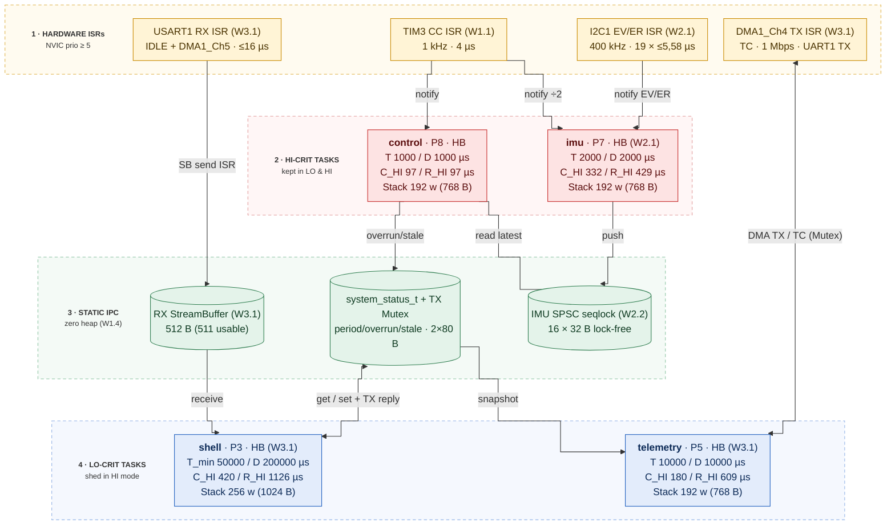

# W4.1 – REPORT & TÀI LIỆU THIẾT KẾ HỆ THỐNG MIXED-CRITICALITY (DESIGN DOC)

- **MSSV**: `2452882` | **MCU**: `STM32F103C8T6` (Cortex-M3 @ 72 MHz, 20 KiB SRAM, 64 KiB Flash)
- **Trạng thái**: Hoàn tất Thiết kế trên giấy (0 dòng code `.c` thực thi), đã kiểm chứng toàn bộ bảng RTA, ngân sách tĩnh và ma trận lỗi bằng `py tools/check_w4e1.py`.
- **Single Source of Truth (SSOT)**: [include/mixed_criticality_design.h](include/mixed_criticality_design.h), [PREDICTION.md](PREDICTION.md), `include/params.h` *(sinh bởi `py tools/gen_params.py 2452882`, bị `.gitignore`)*.
- **Sơ đồ trực quan (PDF Vector)**: [w4e1_system_architecture.pdf](w4e1_system_architecture.pdf) (Kiến trúc 4 tầng) | [w4e1_mode_switch_fsm.pdf](w4e1_mode_switch_fsm.pdf) (Máy trạng thái chuyển chế độ) | Bản tương tác: [w4e1_architecture.html](w4e1_architecture.html) & yEd: [w4e1_architecture.graphml](w4e1_architecture.graphml).

---

## 1. Kết quả Duyệt Thiết kế, Nguồn Kế thừa (Week 1 $\rightarrow$ Week 4) & Sơ đồ Kiến trúc

- **Ngày nộp design doc**: `18/11/2026` | **Ngày được duyệt**: *(chờ mentor duyệt trước khi mở code W4.2)* | **Số vòng tự kiểm tra**: `4` (từ bản nháp lý tưởng $\rightarrow$ đồng bộ $C_{HI}(control)=97\text{ }\mu\text{s}$ $\rightarrow$ nâng `I2C1` 400 kHz đọc 14 B & giảm vòng DMA RX 128 B $\rightarrow$ vá mask `DMA1_Ch5` khi `UART_FLOOD`, bổ sung đường `UART TX Mutex` & truy xuất nguồn từng Week).

### 1.1. Bảng Truy xuất Kế thừa theo từng Tuần (Week 1 $\rightarrow$ Week 3 $\rightarrow$ Week 4)

| Bài nguồn | Cơ chế / Số liệu trích xuất | Vai trò trong thiết kế W4.1 | Tiếp nối sang W4.2 – W4.4 |
|---|---|---|---|
| **W1.2** | DWT CYCCNT tracer (`256 × 8 B`); context switch `-O2`: `219–244 cycles` ($3,0\text{--}3,4\text{ }\mu\text{s}$) | Phân rã $C(control)$ (`+8 µs`); ngân sách RAM mục 15 (`2.304 B`) | W4.3 đo WCRT thực tế & jitter `control` |
| **W1.3** | Công thức lặp cố định RTA (Joseph & Pandya); `SysTick` `-O2` ($\approx 6,8\text{ }\mu\text{s}$) | Chứng minh $R_i \le D_i$ ở `LO/HI/AMC-rtb` & nền ISR $2,10\%$ | W4.3 đối chiếu sai số WCRT $\le 12\%$ |
| **W1.4** | Cấp phát tĩnh 100% (`0 malloc`), `StaticTask_t = 96 B`, `StaticQueue_t = 80 B`, MSP `1.024 B` | Bảng ngân sách RAM 18 mục = **`11.776 / 15.684 B`** | W4.2 `check_api.sh` & stack margin $\le 23\text{ w}$ |
| **W2.1** | Driver `I2C1` EV/ER + timeout `28 ms` + recovery 9 xung SCL (`START/STOP 17,75 µs`, EV $\le 5,583\text{ }\mu\text{s}$) | Vai trò `imu` (nâng 400 kHz đọc burst 14 B), xử lý `SENSOR_UNPLUG` | W4.2 driver MPU6050; W4.3 đo CPU recovery |
| **W2.2** | SPSC ring lock-free dùng `__DMB()` (push `29` / pop `24` cycles $\approx 0,74\text{ }\mu\text{s}$, $B=0$) | Kênh `imu` (500 Hz) $\rightarrow$ `control` (1 kHz) không khóa | W4.2 đảm bảo không blocking giữa `imu` & `control` |
| **W2.4** | `StaticEventGroup_t` (đo `28 B`, dự trù `32 B`) & đồng bộ bit trạng thái | `StaticEventGroup` gom mặt nạ Heartbeat & bit `DEGRADED_MODE` | W4.3 `xEventGroupWaitBits` quan sát suy giảm |
| **W3.1** | `USART1` DMA RX/TX + IDLE + `StreamBuffer` (`511 B` hữu dụng) + `TIM2` 100 kHz + CRC32 (`110 cyc/B`) | Vai trò `telemetry` (`1 Mbps`), `shell` (ring `128 B`), `TIM2`, `UART_FLOOD` | W4.2 shell/telemetry; W4.3 `vTaskGetRunTimeStats` |
| **W3.2** | Tickless Idle + `STOP mode` qua `RTC LSI` ($\approx 40,11\text{ kHz}$), dự báo thoát STOP + PLL $1,71\text{--}2,21\text{ ms}$ | Vai trò `idle_aux` & cơ chế **Adaptive Sleep Gating** (`SLEEP` 1 ms / `STOP` $\ge 5$ ticks) | W4.2 hiện thực `portSUPPRESS_TICKS_AND_SLEEP` |
| **W3.3** | HardFault asm+C lưu `PC/LR/CFSR` vào `.noinit` (`96 B`, canary `0x6C217697`, FNV-1a) | Ngân sách RAM mục 16 (`128 B`) & phục hồi `TASK_HANG` + IWDG $\le 296\text{ ms}$ | W4.3 ghi mã reset lý do khi IWDG nổ |

### 1.2. Hai Chốt Kiến trúc Cốt lõi
1. **Cô lập I2C1 Bus Recovery khỏi ISR (W2.1 $\rightarrow$ W4.1)**: Nếu đặt chuỗi 9 xung SCL ($\approx 90\text{ }\mu\text{s}$) + START/STOP ($17,75\text{ }\mu\text{s}$) trong `I2C1_ER_IRQHandler` (NVIC 6), dù `TIM3_IRQHandler` (NVIC 5) chen ngang được nhưng **task `control`** vẫn bị kẹt tới khi ISR $\approx 120\text{ }\mu\text{s}$ kết thúc $\Rightarrow$ vượt trần jitter `113 µs`. Do đó toàn bộ nhánh recovery chạy ở **ngữ cảnh task `imu` (P7)** với ngắt mở; `control` (P8) preempt tức thời (chỉ còn các critical section ngắn của kernel FreeRTOS, đo bằng DWT ở W4.3).
2. **Adaptive Sleep Gating (`SLEEP` vs `STOP`, W3.2 $\rightarrow$ W4.1)**: Dự báo W3.2 cho thấy thoát `STOP mode` + khóa `HSE/PLL 72 MHz` mất $1,71\text{--}2,21\text{ ms}$ và `STOP` dừng clock APB (`TIM3`, `TIM2`, `DMA1`). Vì vậy giữa các nhịp 1 ms của `control` (hoặc khi DMA bận), `portSUPPRESS_TICKS_AND_SLEEP` chỉ chạy `WFI` ở **`SLEEP mode`** (trễ $< 2\text{ }\mu\text{s}$); chỉ vào **`STOP mode`** (đánh thức bởi `RTC Alarm` EXTI17) khi hệ thống rảnh dài hạn $\ge 5\text{ ticks}$.

### 1.3. Sơ đồ Kiến trúc & Máy Trạng thái Chuyển Chế độ
*(Bản in vector sắc nét đầy đủ xem tại [w4e1_system_architecture.pdf](w4e1_system_architecture.pdf) và [w4e1_mode_switch_fsm.pdf](w4e1_mode_switch_fsm.pdf).)*

- Quy ước: Mọi ISR gọi `...FromISR` có NVIC $\ge 5$ (`configLIBRARY_MAX_SYSCALL_INTERRUPT_PRIORITY = 5`). `HB` = task tự set bit heartbeat vào `StaticEventGroup` (tách riêng sang sơ đồ (b) để tránh giao cắt $K_{2,2}$). `TIM3` đặt lệch pha `SysTick` ($\approx +500\text{ }\mu\text{s}$) và đánh thức `imu` mỗi 2 tick (`notify ÷2`) ngay sau `control` để giao dịch I2C1 kết thúc trước mốc 1 ms kế tiếp.

**(a) Data plane**

**(b) Supervision plane** (Heartbeat W2.4, Run-time stats W3.1, Tickless W3.2, Watchdog & `.noinit` W3.3)

**(c) Máy Trạng thái Chuyển Chế độ (LO-Mode $\leftrightarrow$ HI-Mode $\leftrightarrow$ Watchdog Reset)**

```mermaid
%%{init: {"flowchart": {"curve": "step", "nodeSpacing": 56, "rankSpacing": 68, "padding": 12}}}%%
flowchart LR
    S0(( )):::start -->|boot| LO
    LO("<b>LO-MODE (nominal)</b><br/>5 tasks · U_tasks = 18,14 % (+2,10 % ISR)<br/>R ctrl 70 · imu 235 µs<br/>idle: SLEEP / gated STOP"):::lo
    HI("<b>HI-MODE (degraded)</b><br/>DEGRADED bit · shed tel+shell<br/>R ctrl 97 · imu 429 µs<br/>STOP locked · U_tasks = 26,38 % (+2,10 % ISR)"):::hi
    RST("<b>WATCHDOG RESET</b><br/>.noinit PC/LR/CFSR + reason (W3.3)<br/>IWDG reset ≤ 296 ms"):::rst
    LO -->|"SENSOR_UNPLUG · UART_FLOOD<br/>CPU_OVERLOAD (>100 µs | >76 %)"| HI
    HI -->|"cleared ≥ 10 cycles<br/>and U_total < 50 %"| LO
    LO -->|"TASK_HANG<br/>HardFault"| RST
    HI -->|"hang > 296 ms<br/>IWDG fires"| RST
    RST -->|"reboot +<br/>dump .noinit"| S0
    classDef start fill:#333,stroke:#333
    classDef lo fill:#E3ECFB,stroke:#1F5FBF,color:#0C2A57
    classDef hi fill:#FDE3E3,stroke:#C62828,color:#5B0E0E
    classDef rst fill:#ECE7F6,stroke:#5E35B1,color:#24104F
```

---

## 2. Bảng RTA, Ngân sách Tài nguyên Tĩnh & Ma trận Failure Mode

### 2.1. Bảng RTA (`LO-Mode` vs `HI-Stress / Worst-Case` — khớp `W4E1_RTA_TABLE`)

| Vai trò (`w4e1_task_role_t`) | Crit | Prio | $T_i$ ($\mu\text{s}$) | $D_i$ ($\mu\text{s}$) | $C_{i,LO}$ ($\mu\text{s}$) | $R_{i,LO}$ ($\mu\text{s}$) | $C_{i,HI}$ (`wcet_us`) | $R_{i,HI}$ (`response_time_us`) | Biên $D_i - R_{i,HI}$ ($\mu\text{s}$) | $U_{i,LO}$ (%) | $U_{i,HI}$ (%) |
|---|---|---:|---:|---:|---:|---:|---:|---:|---:|---:|---:|
| `W4E1_ROLE_CONTROL` (`control`) | **HI** | **8** | 1.000 | 1.000 | 70 | 70 | **97** | **97** | **903** *(Jitter: 16)* | 7,00% | 9,70% |
| `W4E1_ROLE_IMU` (`imu`) | **HI** | **7** | 2.000 | 2.000 | 165 | 235 | **332** | **429** | **1.571** *(E2E: 862 $\rightarrow$ 1.138)* | 8,25% | 16,60% |
| `W4E1_ROLE_TELEMETRY` (`telemetry`) | **LO** | **5** | 10.000 | 10.000 | 180 | 415 | **180** *(Shed: 0)* | **609** | **9.391** | 1,80% | 1,80% *(0%)* |
| `W4E1_ROLE_SHELL` (`shell`) | **LO** | **3** | 50.000 | 200.000 | 420 | 835 | **420** *(Shed: 0)* | **1.126** | **198.874** | 0,84% | 0,84% *(0%)* |
| `W4E1_ROLE_IDLE_AUX` (`idle_aux`) | **LO** | **2** | 100.000 | 100.000 | 250 | 1.155 | **250** *(HI: 80)* | **1.376** | **98.624** | 0,25% | 0,25% *(0,08%)* |
| **Tổng 5 Task** | — | — | — | — | — | — | — | — | **Mọi $R_i \le D_i$** | **18,14%** | **29,19%** *(HI-shed: 26,38%)* |
| **Nền ISR (`SysTick` W1.3 + `TIM2` W3.1)** | — | NVIC | 1.000 | — | 21 | — | **21** | — | — | **2,10%** | **2,10%** |
| **Tổng toàn hệ thống** | — | — | — | — | — | — | — | — | **Trần: $\le 76\%$** | **20,24%** | **31,29%** |

- **Kiểm chứng chuyển chế độ AMC-rtb**: Do không có task `LO` nào ưu tiên cao hơn `HI` ($hpL = \emptyset$), công thức $R_i^* = C_i(HI) + \sum_{j \in hpH(i)} \lceil R_i^*/T_j \rceil C_j(HI) + \sum_{k \in hpL(i)} \lceil R_i(LO)/T_k \rceil C_k(LO)$ rút gọn về $R_{control}^* = \mathbf{97\text{ }\mu\text{s}} \le 113\text{ }\mu\text{s}$ và $R_{imu}^* = 332 + \lceil 429/1000 \rceil \times 97 = \mathbf{429\text{ }\mu\text{s}} \le 2.000\text{ }\mu\text{s}$.
- **Kiểm tra chờ bus `imu` (suspension-oblivious, $S = 433\text{ }\mu\text{s}$ ở I2C1 400 kHz)**: $R_{imu}^{e2e} = 332 + 433 + \lceil R/1000 \rceil \times 97 \Rightarrow \mathbf{862\text{ }\mu\text{s}} \le 2.000\text{ }\mu\text{s}$. Jitter hoàn tất $J_{imu} = 530\text{ }\mu\text{s}$ không làm đổi $R$ của `telemetry`, `shell`, `idle_aux`.

### 2.2. Bảng Ngân sách RAM Tĩnh 100% (`W4E1_RAM_BUDGET_TABLE`)
*(Đặt `configSUPPORT_STATIC_ALLOCATION = 1`, `configSUPPORT_DYNAMIC_ALLOCATION = 0`; `StaticTask_t = 96 B` và `StaticQueue_t = 80 B` đo ở W1.4; `StaticStreamBuffer_t = 80 B`, `StaticEventGroup_t = 32 B` là cận trên bảo thủ so với `28 B` đo ở W2.4.)*

| # | Tên hạng mục (`W4E1_RAM_BUDGET_TABLE`) | Nguồn Week | Diễn giải kích thước | Bytes | % Ngân sách |
|---:|---|---|---|---:|---:|
| 1 | `control_task_stack (192w, W1.4)` | **W1.4** | $192 \times 4\text{ B}$ (dự kiến dùng ~110w) | 768 | 4,90% |
| 2 | `imu_task_stack (192w, W1.4/W2.1)` | **W1.4 / W2.1** | $192 \times 4\text{ B}$ (FSM I2C1 + recovery) | 768 | 4,90% |
| 3 | `telemetry_task_stack (192w, W1.4/W3.1)` | **W1.4 / W3.1** | $192 \times 4\text{ B}$ (CRC32 + DMA TX) | 768 | 4,90% |
| 4 | `shell_task_stack (256w, W1.4/W3.1)` | **W1.4 / W3.1** | $256 \times 4\text{ B}$ (Parser + `reply_buf`) | 1.024 | 6,53% |
| 5 | `idle_aux_task_stack (192w, W1.4/W3.2)` | **W1.4 / W3.2** | $192 \times 4\text{ B}$ (Stats + IWDG + Sleep) | 768 | 4,90% |
| 6 | `freertos_idle_and_timer_stacks (2x128w, W1.4)` | **W1.4** | $2 \times 128 \times 4\text{ B}$ (Idle + Timer daemon) | 1.024 | 6,53% |
| 7 | `static_task_tcbs (7x96B StaticTask_t, W1.4)` | **W1.4** | $7 \times 96\text{ B}$ (5 user + Idle + Timer) | 672 | 4,28% |
| 8 | `uart1_rx_dma_ring_buf (DMA1_Ch5 2x64B, W3.1)` | **W3.1** | Vòng DMA RX 128 B (HT/TC mỗi 64 B $\le 13,7\text{ }\mu\text{s}$) | 128 | 0,82% |
| 9 | `uart1_rx_stream_buf_storage (511+1B, W3.1)` | **W3.1** | `StreamBuffer` (511 B hữu dụng + 1 B sentinel) | 512 | 3,26% |
| 10 | `uart1_tx_dma_pingpong_buf (DMA1_Ch4, W3.1)` | **W3.1** | Bộ đệm kép $2 \times 128\text{ B}$ phát 1 Mbps | 256 | 1,63% |
| 11 | `i2c1_trx_and_recovery_ctx (W2.1)` | **W2.1** | Buffer burst 14 B + trạng thái FSM I2C1 | 64 | 0,41% |
| 12 | `imu_spsc_snapshot_ring (16x32B, W2.2)` | **W2.2** | $16 \times 32\text{ B}$ (`w4e2_imu_sample_t` 28 B + 4 B seq) | 512 | 3,26% |
| 13 | `shell_cmd_and_reply_buf (2x128B, W4.2)` | **W4.2** | `cmd_line` (128 B) + `reply_buf` (128 B) | 256 | 1,63% |
| 14 | `static_ipc_control_blocks (2xSem/SB/EG, W1.4-3.1)` | **W1.4/2.4/3.1** | 2 `StaticSemaphore_t` (I2C1 + UART TX: 160 B) + SB (80 B) + EG (32 B) + SPSC hdr (16 B) | 288 | 1,84% |
| 15 | `runtime_stats_and_dwt_trace_buf (W1.2/W4.3)` | **W1.2 / W4.3** | `TaskStatus_t` + mẫu WCRT + 256 sự kiện DWT | 2.304 | 14,69% |
| 16 | `noinit_postmortem_and_wdg_record (W3.3)` | **W3.3** | `.noinit`: `fault_record_t` (96 B) + IWDG reason (32 B) | 128 | 0,82% |
| 17 | `kernel_and_system_globals (.data/.bss, W1.4)` | **W1.4 / W4.2** | FreeRTOS lists (436 B) + `w4e2_system_status_t` (12 B) + dự phòng (64 B) | 512 | 3,26% |
| 18 | `msp_isr_stack_reserve (_Min_Stack_Size, W1.4)` | **W1.4** | Ngăn xếp `MSP` cho các ngắt phần cứng | 1.024 | 6,53% |
| — | **TỔNG RAM TĨNH / BIÊN DƯ (`W4E1_RAM_BUDGET_BYTES = 15.684 B`)** | — | **Đạt (còn dư 3.908 B so với ngân sách; dư 8.704 B so với 20 KiB SRAM)** | **11.776** | **75,08%** |

### 2.3. Ma trận Failure Mode & Suy giảm Có kiểm soát (`W4E1_FAILURE_MODE_TABLE`)

| Kịch bản (`W4.3`) | Nguồn Week | Tài nguyên | Phát hiện & Ngưỡng định lượng | Phản ứng cô lập & Suy giảm có kiểm soát | Ảnh hưởng `control` |
|---|---|---|---|---|---|
| **`SENSOR_UNPLUG`** | **W2.1 / W2.2** | `I2C1` & `MPU6050` | `I2C1_ER` (`AF/BERR/ARLO`, $<10\text{ }\mu\text{s}$) hoặc `ulTaskNotifyTake` $>28\text{ ms}$; `control` thấy tuổi mẫu $>3\text{ tick}$ (`W4E1_DESIGN_IMU_STALE_TICKS`). | Set `W4E3_BIT_DEGRADED_MODE_ENTERED`; `imu` chạy tối đa 9 xung SCL trong task context (mở ngắt); `control` dùng safe-hold không block. | **0 trễ deadline** ($R=97\text{ }\mu\text{s} \le 113\text{ }\mu\text{s}$) |
| **`UART_FLOOD`** | **W3.1** | `USART1 RX`, `DMA1_Ch5`, `StreamBuffer` | `xStreamBufferSendFromISR < len` (`dropped > 0`), cờ `ORE/FE/NE`, hoặc parse shell $>200\text{ ms}$. | Set `W4E3_BIT_DEGRADED_MODE_ENTERED`; mask cả **`USART1 IDLEIE` và `DMA1_Ch5 HTIE/TCIE`** trong `50 ms` cooldown, xả khung lỗi, đình chỉ `shell` & hạ `telemetry` về 10 Hz. | **0 trễ deadline** (cắt bão 1.562,5 Hz) |
| **`CPU_OVERLOAD`** | **W1.2 / W3.1 / W3.2** | CPU (76%) & Jitter (113 $\mu\text{s}$) | DWT phát hiện jitter $>100\text{ }\mu\text{s}$ (`W4E1_DESIGN_JITTER_ALARM_US`), WCRT $>+12\%$ RTA, hoặc `TIM2` báo CPU $>76\%$. | Vào `HI-Mode`: đình chỉ `shell` (P3) & `telemetry` (P5), khóa `STOP mode` ở `idle_aux` (P2) để giữ PLL 72 MHz luôn nóng; thu hồi $2,81\%$ CPU. | **0 trễ deadline** *(trừ task giả Prio $\ge 8$ $\rightarrow$ IWDG xử lý)* |
| **`TASK_HANG`** | **W2.4 / W3.3** | Liveness & RAM tĩnh | Mặt nạ heartbeat trên `StaticEventGroup` (chỉ kiểm vai trò đang chạy; `shell` chờ SB timeout $\le 50\text{ ms}$) thiếu bit sau `100 ms`; HWM $<23\text{ w}$; HardFault. | Ghi ID task treo, `PC/LR/CFSR` và `reset_reason` vào `.noinit` (canary `0x6C217697`, FNV-1a); kích hoạt IWDG/NVIC reset trong **$\le 296\text{ ms}$** (prescaler `/8`, reload `1109` an toàn cho LSI 30–60 kHz). | Phục hồi cứng trong **$\le 296\text{ ms}$** |

---

## 3. Giải thích Sai lệch Định lượng (Ước lượng Sơ bộ vs Bảng RTA Chính thức)

| Vai trò | $C_{\text{naive}}$ ($\mu\text{s}$) | $C_{\text{approved}}$ ($\mu\text{s}$) | $\Delta C$ ($\mu\text{s}$) | Định lượng nguồn gốc hiệu chỉnh từ dữ liệu W1–W3 |
|---|---:|---:|---:|---|
| `control` | 62 | **97** | **+35** | Thuật toán cơ sở $62 = 1$ (SPSC W2.2) $+ 56$ (PID) $+ 5$ (status/HB). Cộng: `TIM3` ISR + context switch W1.2 (`+8`), nhánh safe-hold (`+11`), 1 lần ISR UART RX W3.1 (`+16`). |
| `imu` | 105 | **332** | **+227** | Cơ sở $105 = 7$ (wake) $+ 98$ (convert + SPSC). Cộng: 19 lần ISR `I2C1_EV/ER` đọc 14 B ở trần $5,583\text{ }\mu\text{s}$ đo ở W2.1 (`+107`), cộng recovery 9 xung SCL + START/STOP + re-init (`+120`). |
| `telemetry` | 150 | **180** | **+30** | Cộng chi phí cấu hình `DMA1_Ch4` TX 1 Mbps và ngắt TC trên nền CRC32 70 B ($107\text{ }\mu\text{s}$, W3.1). |
| `shell` | 350 | **420** | **+70** | Cộng ISR `USART1 IDLE` + `DMA1_Ch5` chép 70 B vào `StreamBuffer` (`+25`, W3.1) và format `reply_buf` (`+45`). |
| `idle_aux` | 180 | **250** | **+70** | Cộng `uxTaskGetSystemState` (`TIM2` W3.1) + 5$\times$`uxTaskGetStackHighWaterMark` (`+50`) và chia 64-bit hiệu chuẩn LSI W3.2 (`+20`). |

---

## 4. Trả lời Câu hỏi Trade-off: Thứ tự Priority & IPC Không khóa

Thiết kế bám sát thứ tự **Rate-Monotonic / Criticality-Monotonic** và `W4E2_TASK_PRIORITY = {2, 3, 5, 7, 8}` (trong `week4/ex2/include/params.h`, sinh từ `gen_params.py`):
$$\text{Priority}(\texttt{control}=8) > \text{Priority}(\texttt{imu}=7) > \text{Priority}(\texttt{telemetry}=5) > \text{Priority}(\texttt{shell}=3) > \text{Priority}(\texttt{idle\_aux}=2)$$

- **Phạm vi chứng minh**: Bảng dưới chứng minh **mọi hoán vị đưa task khác lên trên `control`** hoặc **dùng Mutex chặn thay cho SPSC** đều phá vỡ trần jitter `113 µs`. Riêng hoán vị giữa 2 task LO (`telemetry` $\leftrightarrow$ `shell`) vẫn schedulable ($R_{telemetry} = 180 + 2\cdot 97 + 332 + 420 = 1.126 \le 10.000\text{ }\mu\text{s}$), nhưng đánh mất thứ tự Rate-Monotonic và trái `W4E2_TASK_PRIORITY`.

| Phương án so sánh | Phép tính RTA cho `control` | $R_{control}$ ($\mu\text{s}$) | Trần ($\mu\text{s}$) | Kết luận |
|---|---|---:|---:|---|
| **Thiết kế chuẩn (`control=8 > imu=7 > ...`)** | $R_{control} = C_{control}$ | **97** | $\le 113$ | **ĐẠT** (dư $16\text{ }\mu\text{s}$). |
| **Đảo `imu(8) > control(7)`** | LO: $70 + 165 = 235$; HI: $97 + 332 = 429$ | **235 / 429** | $\le 113$ | **VI PHẠM** (vượt $+122\text{ / }+316\text{ }\mu\text{s}$). |
| **Đặt `telemetry(8) > control(7)`** | $97 + 180 = 277$ | **277** | $\le 113$ | **VI PHẠM** (task LO chặn task HI, vượt $+164\text{ }\mu\text{s}$). |
| **Đặt `shell(8) > control(7)`** | $97 + 420 = 517$ (khi flood $\rightarrow \infty$) | **517+** | $\le 113$ | **SỤP ĐỔ** (Criticality Inversion khi `UART_FLOOD`). |
| **Dùng `I2C1 Mutex` chặn giữa `imu` và `control`** | $C_{control} + B_{bus,400k} = 97 + 433 = 530$ | **530** | $\le 113$ | **VI PHẠM** $\Rightarrow$ bắt buộc dùng **SPSC lock-free** (W2.2). |

---

## 5. Tóm tắt Kiểm chứng, Phân tích Độ nhạy & Khoảng trống cần đo ở W4.2 / W4.3

### 5.1. Kiểm chứng tự động & 6 Quyết định Hiệu chỉnh Cốt lõi
- Toàn bộ toán học RTA (`LO`/`HI`/`E2E`/`J_imu`), CPU, RAM (`11.776 B`), đối chiếu SSOT trên 5 file, `arm-none-eabi-gcc -fsyntax-only -std=c99 -Wall -Wextra -Werror -pedantic` và quy tắc `check_api.sh` đều kiểm chứng một lệnh bằng `py tools/check_w4e1.py` (**PASS**).
- **6 điểm hiệu chỉnh quan trọng đã khóa trong hồ sơ**:
  1. **I2C1 400 kHz cho burst 14 B (`accel+gyro`)**: 100 kHz kéo bus $\approx 1.619\text{ }\mu\text{s}$ làm $R_{imu}^{e2e} \approx 2.170\text{ }\mu\text{s} > 2.000\text{ }\mu\text{s}$; nâng 400 kHz đưa $R_{imu}^{e2e} = 862\text{ }\mu\text{s}$.
  2. **Giảm vòng `DMA1_Ch5` RX 256 $\rightarrow$ 128 B & mask cả `DMA1_Ch5` khi flood**: Giữ mỗi lần chép ISR $\le 64\text{ B}$ ($\approx 13,7\text{ }\mu\text{s} \le 16\text{ }\mu\text{s}$ trong $C_{HI}(control)$) và dập bão ngắt 1.562,5 Hz khi flood liên tục.
  3. **Đồng bộ pha `TIM3` lệch `SysTick` & kích `imu` bằng `TIM3 ÷2`**: Ngăn `SysTick` và chuỗi `I2C1_EV` rơi vào cửa sổ `[0..97 µs]` của `control`.
  4. **Ngưỡng báo động jitter `100 µs` (< trần `113 µs`) & ngưỡng stale `> 3 tick`**: Phát hiện sớm `CPU_OVERLOAD` trước khi vỡ hạn và tránh báo stale giả khi tuổi mẫu khỏe đạt 3 tick.
  5. **Định cỡ `IWDG` theo biên LSI 30–60 kHz**: Prescaler `/8`, reload `1109` đảm bảo timeout $\le 296\text{ ms}$ ở 30 kHz và $\ge 148\text{ ms}$ ở 60 kHz ($>$ chu kỳ kick `100 ms`).
  6. **Mặt nạ Heartbeat động & `UART TX Mutex`**: HI-Mode bỏ `telemetry`/`shell` khỏi mặt nạ để không kích `TASK_HANG` giả; `shell` và `telemetry` chia sẻ `USART1 TX` qua `StaticSemaphore_t` (không chạm `control`).

### 5.2. Phân tích Độ nhạy (Cận bảo thủ khi `imu` gặp recovery dài: $C_{HI}(imu) = 729\text{ }\mu\text{s}$)
Giả sử $C_{HI}(imu) = 7 + 98 + 107\text{ (19 ISR trần)} + 427\text{ (wall-clock recovery lớn nhất W2.1)} + 90\text{ (9 xung SCL)} = 729\text{ }\mu\text{s}$, bus wait $S = 433\text{ }\mu\text{s} \Rightarrow R_{imu}^{e2e} = 1.356\text{ }\mu\text{s}$ và $J_{imu} = 1.356 - 729 = \mathbf{627\text{ }\mu\text{s}}$:

| Vai trò | $R_{HI}$ chính thức ($\mu\text{s}$) | $R_{HI}$ bảo thủ thuần CPU ($\mu\text{s}$) | $R_{HI}$ bảo thủ có $J_{imu}=627\text{ }\mu\text{s}$ ($\mu\text{s}$) | Deadline $D$ ($\mu\text{s}$) |
|---|---:|---:|---:|---:|
| `control` | 97 | 97 | **97** | 1.000 *(jitter 113)* |
| `imu` (CPU / E2E chờ bus) | 429 / 862 | 826 / 1.356 | **826 / 1.356** | 2.000 |
| `telemetry` | 609 | 1.103 | **1.103** | 10.000 |
| `shell` | 1.126 | 1.523 | **2.349** | 200.000 |
| `idle_aux` | 1.376 | 1.773 | **2.599** | 100.000 |
| **CPU (5 task / tổng kèm ISR)** | **29,19% / 31,29%** | **49,04% / 51,14%** | **49,04% / 51,14%** | **76,00%** |

### 5.3. Năm Khoảng trống Dữ liệu Bắt buộc phải Đo trên Board ở W4.2 / W4.3
1. Đo WCET thực tế từng vai trò bằng `DWT->CYCCNT` (PID `control`, quy đổi `imu`, parser `shell`, housekeeping `idle_aux`).
2. Đo sườn lên SCL ($\le 300\text{ ns}$), số lần vào ISR và thời gian bus của burst 14 B ở **I2C1 400 kHz** trên MPU6050 thật.
3. Đo thời gian CPU thực tế của nhánh phát 9 xung SCL recovery (W2.1 có `PULSES=0`) khi giữ SDA LOW cưỡng bức.
4. Đo độ trễ lớn nhất của kernel critical section (`BASEPRI = 5`) bên trong cửa sổ `control` (phần này trừ vào biên jitter `16 µs`).
5. Kiểm tra `dma_late = 0`, `dropped = 0` với vòng `DMA1_Ch5` RX `128 B` ở `1 Mbps` và đo kích thước thật qua file `.map` / `uxTaskGetStackHighWaterMark()`.
