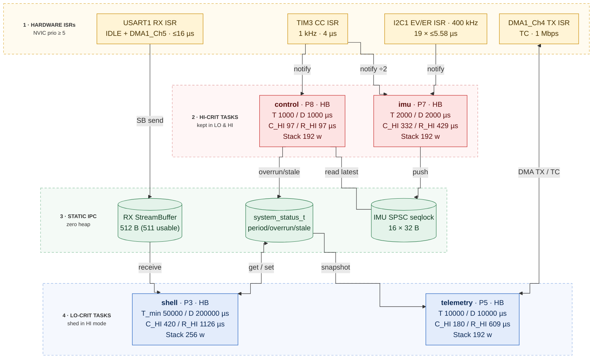
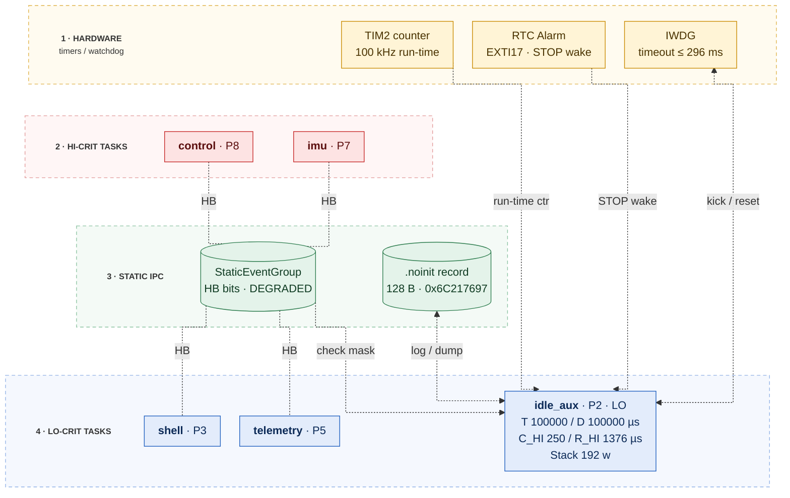

# W4.1 – REPORT & TÀI LIỆU THIẾT KẾ HỆ THỐNG MIXED-CRITICALITY (DESIGN DOC)

- **MSSV**: `2452882` | **Vi điều khiển**: `STM32F103C8T6` (Cortex-M3 @ 72 MHz, 20 KiB SRAM, 64 KiB Flash)
- **Trạng thái**: Hoàn tất Thiết kế Kiến trúc, Tính toán RTA bằng tay, Ngân sách Tĩnh và Ma trận Failure Mode (0 dòng code `.c` thực thi theo đúng quy định W4.1).
- **Nguồn dữ liệu chuẩn (Single Source of Truth)**: `include/params.h` (file sinh bởi `python tools/gen_params.py 2452882`, bị `.gitignore` nên không có trên GitHub), [include/mixed_criticality_design.h](include/mixed_criticality_design.h), [PREDICTION.md](PREDICTION.md), [w4e1_architecture.graphml](w4e1_architecture.graphml), [w4e1_architecture.html](w4e1_architecture.html).

---

## 1. Kết quả duyệt thiết kế & Kiến trúc Tổng thể

- **Ngày nộp design doc cho mentor**: `18/11/2026`. **Ngày được duyệt**: *(chờ mentor ký duyệt trước khi mở code W4.2)*. **Số vòng sửa nội bộ**: `3` (vòng 1: chuyển từ mô hình lý tưởng sang Worst-Case có nhiễu ISR/Bus-Recovery; vòng 2 – audit 18/11/2026: $C_{HI}(control)$ 90 → **97 µs**, thống nhất ngưỡng jitter 100/113 µs, sửa trích dẫn số đo; vòng 3 – audit 19/11/2026: `imu` đọc burst 14 byte accel + gyro nên chuyển `I2C1` lên **400 kHz**, thêm kiểm tra thời gian hoàn tất có chờ bus — chi tiết ở §5).
- **Các điểm đã tự rà soát và khóa chặt định lượng trước khi trình duyệt**:
  1. **Cô lập nhánh I2C1 Bus Recovery khỏi ISR**: Theo tính toán từ W2.1 (100 kHz; nhánh này chưa được kích hoạt khi đo, xem §5), chuỗi phát 9 xung SCL tốn $\approx 90\text{ }\mu\text{s}$ cộng xung START/STOP $17,75\text{ }\mu\text{s}$. Nếu đặt trong `I2C1_ER_IRQHandler` (NVIC 6), `TIM3_IRQHandler` (NVIC 5) vẫn chen ngang được, nhưng **task** `control` không thể chạy cho tới khi ISR $\approx 120\text{ }\mu\text{s}$ kết thúc ⇒ đứt trần jitter `113 µs`. Thiết kế W4.1 chuyển toàn bộ nhánh recovery xuống **task context của `imu` (Priority 7)** với ngắt được mở, giúp `control` (Priority 8) preempt tức thời: không có tài nguyên dùng chung nào chặn `control` (chỉ còn các critical section ngắn của kernel, xem §5 F19).
  2. **Giải quyết xung đột Clock Domain giữa `STOP mode` (W3.2) và `TIM3 1 kHz`**: Theo dự báo của W3.2 (chưa đo tách riêng được vì chân PA0 chỉ lên mức cao sau khi PLL đã khóa), thoát `STOP mode` và chờ thạch anh `HSE 8 MHz` + khóa lại `PLL 72 MHz` mất **$\approx 1,71\text{--}2,21\text{ ms}$**, đồng thời `STOP mode` dừng toàn bộ xung nhịp APB1/AHB (`TIM3`, `TIM2`, `DMA1`). Do đó, hook `portSUPPRESS_TICKS_AND_SLEEP` áp dụng cơ chế **Sleep Gating**: khi vòng điều khiển 1 kHz đang chạy bình thường (khoảng rảnh $< 1\text{ ms}$) hoặc DMA đang bận, hệ thống chỉ dùng lệnh `WFI` ở **`SLEEP mode`** (giữ nguyên PLL 72 MHz và các bộ định thời, trễ đánh thức $< 2\text{ }\mu\text{s}$); chỉ khi hệ thống được đưa vào trạng thái rảnh dài hạn ($\ge 5\text{ ticks}$) mới hạ xuống **`STOP mode`** qua `RTC LSI`.

### Sơ đồ Kiến trúc (4 tầng: Hardware ISRs → HI-Criticality Tasks → Static IPC → LO-Criticality Tasks)

Quy ước chung cho cả 3 sơ đồ dưới đây và cho [w4e1_architecture.html](w4e1_architecture.html) / [w4e1_architecture.graphml](w4e1_architecture.graphml):

- Mũi tên = chiều dữ liệu/sự kiện; `<-->` = hai chiều thật (ví dụ `telemetry` khởi động DMA, ISR `TC` báo xong); đường không mũi tên = đọc không khóa (seqlock reader không ghi gì).
- Nét liền = đường dữ liệu; nét đứt = giám sát/điều khiển (heartbeat, watchdog, run-time stats).
- `HB` trong tên task = task đó tự set bit heartbeat của mình trong `StaticEventGroup` (`xEventGroupSetBits`). Heartbeat được tách sang sơ đồ *Supervision plane* vì vẽ chung với data plane thì cặp {`control`,`imu`} × {`SPSC`,`EventGroup`} bắt buộc sinh giao cắt (đồ thị K2,2 giữa hai tầng liền kề).
- NVIC: mọi ISR gọi API `...FromISR` có mức ưu tiên số học **≥ 5** (`configLIBRARY_MAX_SYSCALL_INTERRUPT_PRIORITY = 5`, xem `week3/ex2|ex3/include/FreeRTOSConfig.h`).

**(a) Data plane**

**(b) Supervision plane** (heartbeat, run-time stats, tickless wake-up, watchdog, post-mortem)

### Máy Trạng thái Chuyển Chế độ (LO-Mode ↔ HI-Mode ↔ Watchdog Reset)

```mermaid
%%{init: {"flowchart": {"curve": "step", "nodeSpacing": 60, "rankSpacing": 70, "padding": 12}}}%%
flowchart LR
    S0(( )):::start -->|boot| LO
    LO("<b>LO-MODE (nominal)</b><br/>5 tasks · U = 18.14 %<br/>R ctrl 70 · imu 235 µs<br/>idle: SLEEP / gated STOP"):::lo
    HI("<b>HI-MODE (degraded)</b><br/>DEGRADED bit · shed tel+shell<br/>R ctrl 97 · imu 429 µs<br/>STOP locked · U = 26.38 %"):::hi
    RST("<b>WATCHDOG RESET</b><br/>.noinit PC/LR/CFSR + reason<br/>reset ≤ 296 ms"):::rst
    LO -->|"SENSOR_UNPLUG · UART_FLOOD<br/>CPU_OVERLOAD"| HI
    HI -->|"cleared ≥ 10 cycles<br/>and U < 50 %"| LO
    LO -->|"TASK_HANG<br/>HardFault"| RST
    HI -->|"hang > 296 ms<br/>IWDG fires"| RST
    RST -->|"reboot +<br/>dump .noinit"| S0
    classDef start fill:#333,stroke:#333
    classDef lo fill:#E3ECFB,stroke:#1F5FBF,color:#0C2A57
    classDef hi fill:#FDE3E3,stroke:#C62828,color:#5B0E0E
    classDef rst fill:#ECE7F6,stroke:#5E35B1,color:#24104F
```

- `CPU_OVERLOAD` kích hoạt khi jitter `control` > **100 µs** (ngưỡng báo động `W4E1_DESIGN_JITTER_ALARM_US`, nằm dưới trần cứng **113 µs**) hoặc tổng CPU > **76 %**.
- Ở `LO-Mode` mặt nạ heartbeat gồm `control`, `imu`, `telemetry`, `shell`; ở `HI-Mode` chỉ còn `control`, `imu`, nên việc chủ động đình chỉ `telemetry`/`shell` không bị hiểu nhầm là `TASK_HANG`. Bản thân `idle_aux` là bên kiểm tra nên không nằm trong mặt nạ; nó được `IWDG` giám sát.
- `imu` được `TIM3_IRQHandler` đánh thức mỗi 2 tick (cạnh `notify ÷2`), cùng pha với `control`: giao dịch `I2C1` bắt đầu ngay sau khi `control` chạy xong và kết thúc trước mốc 1 ms kế tiếp (hoàn tất $\le 862\ \mu s$), nên chuỗi ngắt `I2C1` không rơi vào cửa sổ của `control` (§5 F16).

---

## 2. Số đo / Đối chiếu Bảng RTA và Ngân sách Tài nguyên

### 2.1. Bảng Phân tích Lập lịch (Response Time Analysis – RTA)
Bảng dưới đây trình bày song song hai chế độ vận hành: **`LO-Mode` (Danh định)** và **`HI-Stress / Worst-Case` (Tất cả tác vụ chạy ở $C_{HI}$ kèm nhánh phục hồi lỗi)** — các con số cột `HI-Stress` được niêm yết chính thức trong `W4E1_RTA_TABLE` tại [include/mixed_criticality_design.h](include/mixed_criticality_design.h):

| Vai trò (`w4e1_task_role_t`) | Mức độ (`Crit`) | Priority | $T_i$ ($\mu\text{s}$) | $D_i$ ($\mu\text{s}$) | $C_{i,LO}$ ($\mu\text{s}$) | $R_{i,LO}$ ($\mu\text{s}$) | $C_{i,HI}$ (`wcet_us`) | $R_{i,HI}$ (`response_time_us`) | Biên $D_i - R_{i,HI}$ ($\mu\text{s}$) | Tải $U_{i,LO}$ (%) | Tải $U_{i,HI}$ (%) |
|---|---|---:|---:|---:|---:|---:|---:|---:|---:|---:|---:|
| `W4E1_ROLE_CONTROL` (`control`) | **HI** | **8** | 1.000 | 1.000 | 70 | 70 | **97** | **97** | **903** *(Jitter: 16)* | 7,00% | 9,70% |
| `W4E1_ROLE_IMU` (`imu`) | **HI** | **7** | 2.000 | 2.000 | 165 | 235 | **332** | **429** | **1.571** *(hoàn tất kể cả chờ bus: 862 → 1.138)* | 8,25% | 16,60% |
| `W4E1_ROLE_TELEMETRY` (`telemetry`) | **LO** | **5** | 10.000 | 10.000 | 180 | 415 | **180** *(Shed: 0)* | **609** | **9.391** | 1,80% | 1,80% *(0%)* |
| `W4E1_ROLE_SHELL` (`shell`) | **LO** | **3** | 50.000 | 200.000 | 420 | 835 | **420** *(Shed: 0)* | **1.126** | **198.874** | 0,84% | 0,84% *(0%)* |
| `W4E1_ROLE_IDLE_AUX` (`idle_aux`) | **LO** | **2** | 100.000 | 100.000 | 250 | 1.155 | **250** *(HI: 80)* | **1.376** | **98.624** | 0,25% | 0,25% *(0,08%)* |
| **Tổng 5 Task** | — | — | — | — | — | — | — | — | **Mọi $R_i \le D_i$** | **18,14%** | **29,19%** *(HI-shed: 26,38%)* |
| **Nền ISR độc lập (`SysTick` + `TIM2`)** | — | NVIC | 1.000 | — | 21 | — | **21** | — | — | **2,10%** | **2,10%** |
| **Tổng toàn hệ thống** | — | — | — | — | — | — | — | — | **Trần: $\le 76\%$** | **20,24%** | **31,29%** |

#### Kiểm chứng điều kiện chuyển chế độ AMC-rtb (Adaptive Mixed-Criticality Response-Time Bound)
Với mỗi task `HI` $i$, AMC-rtb tính thời gian phản hồi khi chuyển chế độ xảy ra giữa chừng:
$$R_i^* = C_i(HI) + \sum_{j \in hpH(i)} \left\lceil \frac{R_i^*}{T_j} \right\rceil C_j(HI) + \sum_{k \in hpL(i)} \left\lceil \frac{R_i(LO)}{T_k} \right\rceil C_k(LO)$$
Ở thiết kế này không có task `LO` nào có priority cao hơn `control` hoặc `imu` ($hpL = \emptyset$), nên số hạng cuối bằng 0 và AMC-rtb trùng với RTA ở `HI-Mode`:
1. **`control` (Priority 8)**, $hpH = \emptyset$:
   $$R_{control}^* = C_{control}(HI) = \mathbf{97\text{ }\mu\text{s}} \le W4E1\_CONTROL\_LOOP\_JITTER\_MAX\_US\text{ }(113\text{ }\mu\text{s}) < D_{control}\text{ }(1.000\text{ }\mu\text{s})$$
2. **`imu` (Priority 7)**, $hpH = \{control\}$:
   $$R_{imu}^* = 332 + \left\lceil \frac{429}{1000} \right\rceil \times 97 = \mathbf{429\text{ }\mu\text{s}} \le D_{imu}\text{ }(2.000\text{ }\mu\text{s})$$
3. **Thời gian hoàn tất của `imu` kể cả chờ bus** (RTA cổ điển chỉ đếm thời gian CPU; `imu` tự treo $S \approx 433\ \mu s$ trên `ulTaskNotifyTake()` trong lúc bus 400 kHz truyền 14 byte). Coi $S$ như thời gian chạy (*suspension-oblivious*, cận an toàn):
   $$R_{imu}^{e2e} = 332 + 433 + \left\lceil \frac{R}{1000} \right\rceil \times 97 = 765 \rightarrow \mathbf{862\text{ }\mu\text{s}} \le 2.000\text{ }\mu\text{s}$$
   Jitter hoàn tất $J_{imu} = 862 - 332 = 530\ \mu s$ đưa vào $\lceil (R + J_{imu})/T_{imu} \rceil$ cho `telemetry`, `shell`, `idle_aux` không đổi kết quả nào. Nếu giữ 100 kHz ($S \approx 1.619\ \mu s$) thì $R_{imu}^{e2e} \approx 2.170\ \mu s > D$ — đây là lý do chuyển 400 kHz (§5 F14).

### 2.2. Bảng Ngân sách RAM Tĩnh 100% (`W4E1_RAM_BUDGET_TABLE`)
Toàn bộ hệ thống sử dụng `configSUPPORT_STATIC_ALLOCATION = 1` và `configSUPPORT_DYNAMIC_ALLOCATION = 0` (`sizeof(StaticTask_t) = 96 B` và `sizeof(StaticQueue_t) = 80 B` đo ở W1.4, dùng cho cả `StaticSemaphore_t`; `StaticStreamBuffer_t = 80 B` và `StaticEventGroup_t = 32 B` là **cận trên bảo thủ**, W2.4 đo `StaticEventGroup_t = 28 B`; W4.2 đối chiếu lại bằng file `.map`):

| STT | Tên đối tượng trong `W4E1_RAM_BUDGET_TABLE` | Diễn giải kích thước & Căn chỉnh (8-byte aligned) | Dung lượng (Bytes) | Tỷ lệ / Ngân sách |
|---:|---|---|---:|---:|
| 1 | `control_task_stack (192 words)` | $192\text{ words} \times 4\text{ B}$ (dự kiến dùng ~110w, dư ~82w) | 768 | 4,90% |
| 2 | `imu_task_stack (192 words)` | $192\text{ words} \times 4\text{ B}$ (FSM I2C1 + Bus Recovery) | 768 | 4,90% |
| 3 | `telemetry_task_stack (192 words)` | $192\text{ words} \times 4\text{ B}$ (Đóng gói khung + CRC32 + DMA TX) | 768 | 4,90% |
| 4 | `shell_task_stack (256 words)` | $256\text{ words} \times 4\text{ B}$ (Parser lệnh + xử lý `reply_buf`) | 1.024 | 6,53% |
| 5 | `idle_aux_task_stack (192 words)` | $192\text{ words} \times 4\text{ B}$ (Run-time stats + IWDG + Tickless) | 768 | 4,90% |
| 6 | `freertos_idle_and_timer_stacks (2x128w)` | $2 \times 128\text{ words} \times 4\text{ B}$ (Idle Task + Timer Daemon W1.4) | 1.024 | 6,53% |
| 7 | `static_task_tcbs (7x96B StaticTask_t)` | $7\text{ tasks} \times 96\text{ B}$ (`StaticTask_t` thực đo ở W1.4) | 672 | 4,28% |
| 8 | `uart1_rx_dma_ring_buf (DMA1_Ch5)` | Bộ đệm vòng DMA nhận `USART1` (chuẩn W3.1) | 256 | 1,63% |
| 9 | `uart1_rx_stream_buf_storage (W3.1)` | Vùng nhớ `StreamBuffer` (511 B hữu dụng + 1 B sentinel) | 512 | 3,26% |
| 10 | `uart1_tx_dma_pingpong_buf (DMA1_Ch4)` | Bộ đệm kép $2 \times 128\text{ B}$ phát DMA 1 Mbps không chờ | 256 | 1,63% |
| 11 | `i2c1_trx_and_recovery_ctx (W2.1)` | Bộ đệm khung đọc/ghi MPU6050 + biến trạng thái FSM I2C1 | 64 | 0,41% |
| 12 | `imu_spsc_snapshot_ring (16x32B W2.2)` | 16 ô $\times 32\text{ B}$ lưu `w4e2_imu_sample_t` (28 B + 4 B seq) | 512 | 3,26% |
| 13 | `shell_cmd_and_reply_buf (2x128B)` | Bộ đệm dòng lệnh `cmd_line` (128 B) + `reply_buf` (128 B) | 256 | 1,63% |
| 14 | `static_ipc_control_blocks (Sem/SB/EG)` | 2 `StaticSemaphore_t` (160 B) + 1 `StaticStreamBuffer_t` (80 B) + 1 `StaticEventGroup_t` (32 B) + SPSC index (16 B) | 288 | 1,84% |
| 15 | `runtime_stats_and_dwt_trace_buf` | Mảng `TaskStatus_t` + mẫu WCRT/Jitter + 256 sự kiện DWT (W1.2) | 2.304 | 14,69% |
| 16 | `noinit_postmortem_and_wdg_record (W3.3)` | Section `.noinit` lưu `fault_record_t` (96 B) + lý do reset IWDG (32 B) | 128 | 0,82% |
| 17 | `kernel_and_system_globals (.data/.bss)` | Biến scheduler/timer FreeRTOS (236 + 188 + 12 = 436 B ở W1.4) + `w4e2_system_status_t` (3 × `uint32_t` = 12 B) + 64 B dự phòng | 512 | 3,26% |
| 18 | `msp_isr_stack_reserve (_Min_Stack_Size)` | Ngăn xếp chính `MSP` dùng cho các ngắt phần cứng (chuẩn W1.4) | 1.024 | 6,53% |
| — | **TỔNG RAM TĨNH THIẾT KẾ** | **Đạt chuẩn `< W4E1_RAM_BUDGET_BYTES` (15.684 B)** | **11.904** | **75,90%** |
| — | **Biên an toàn RAM còn dư (Margin)** | $15.684 - 11.904\text{ B}$ *(Còn dư $8.576\text{ B}$ so với 20 KiB vật lý)* | **+3.780** | **+24,10%** |

### 2.3. Ma trận Failure Mode & Suy giảm Có kiểm soát (`W4E1_FAILURE_MODE_TABLE`)

| Kịch bản lỗi (`W4.3`) | Tài nguyên bị tác động | Cơ chế phát hiện & Độ trễ phát hiện (Detection Latency) | Phản ứng cô lập & Chế độ suy giảm có kiểm soát (Controlled Response) | Ảnh hưởng tới `control` (1 kHz) |
|---|---|---|---|---|
| **`SENSOR_UNPLUG`** | Bus `I2C1` (PB6/PB7) & Cảm biến `MPU6050` | 1) Ngắt `I2C1_ER_IRQn` bắt cờ `AF / BERR / ARLO` tức thời ($< 10\text{ }\mu\text{s}$) hoặc `ulTaskNotifyTake` quá hạn `28 ms` (W2.1). 2) `control` kiểm tra `xTaskGetTickCount() - sample_tick > 3 tick` (`W4E1_DESIGN_IMU_STALE_TICKS`; khi khỏe tuổi mẫu tối đa là 3 tick: chu kỳ 2 ms + dao động thời điểm hoàn tất + lượng tử tick) và tăng `imu_stale_count`. | - Bật bit `W4E3_BIT_DEGRADED_MODE_ENTERED` trên EventGroup. - Task `imu` (Prio 7) chạy tối đa 9 xung SCL recovery (W2.1) trong ngữ cảnh task (mở ngắt). - `control` (Prio 8) đọc không khóa, giữ nguyên tư thế an toàn (safe-hold) khi mẫu cũ. | **0 trễ deadline** ($R_{control} = 97\text{ }\mu\text{s} \le 113\text{ }\mu\text{s}$). |
| **`UART_FLOOD`** | `USART1 RX`, `DMA1_Ch5` & `StreamBuffer` | 1) `xStreamBufferSendFromISR` trả về số byte ghi $< \text{len}$ (`dropped > 0`) hoặc cờ `USART1->SR` báo `ORE / FE / NE`. 2) Thời gian xử lý dòng lệnh vượt `W4E2_SHELL_CMD_TIMEOUT_MS` (**200 ms**). | - Bật bit `W4E3_BIT_DEGRADED_MODE_ENTERED`. - Tắt tạm thời ngắt `USART1_CR1_IDLEIE` & `DMA1_Channel5` trong `50 ms` (cooldown) để dập bão ngắt. - Xóa khung lỗi, đình chỉ `shell` và giảm tần số `telemetry` xuống 10 Hz. | **0 trễ deadline** (Cắt bão ISR trước khi ăn vào trần jitter $113\text{ }\mu\text{s}$). |
| **`CPU_OVERLOAD`** | Ngân sách CPU (76%) & Trần Jitter `TIM3` ($113\text{ }\mu\text{s}$) | 1) Bộ đo `DWT->CYCCNT` đầu/cuối chu kỳ `control` phát hiện jitter $> 100\text{ }\mu\text{s}$ (ngưỡng báo động, dưới trần cứng $113\text{ }\mu\text{s}$) hoặc WCRT tăng $> 12\%$ so với RTA. 2) `TIM2` 100 kHz báo tổng tải CPU $> 76\%$. | - Chuyển tức thời sang **`HI-Criticality Mode`**: Đình chỉ 2 task `LO-Criticality` (`shell` Prio 3, `telemetry` Prio 5), khóa `STOP mode` ở `idle_aux` (Prio 2) để giữ PLL 72 MHz luôn nóng. - Thu hồi $2,81\%$ CPU và loại bỏ toàn bộ nhiễu DMA/IPC phụ. | **0 trễ deadline** (Trừ khi lỗi tiêm task giả ở Priority $\ge 8$ — đã khai báo trước để IWDG phục hồi). |
| **`TASK_HANG`** | Tiến trình Task & Bộ nhớ Tĩnh dùng chung | 1) Mỗi task phải set bit heartbeat riêng vào `EventGroup` (`shell` chờ `xStreamBufferReceive` với timeout $\le 50\text{ ms}$ để vẫn set bit khi không có lệnh). Task giám sát kiểm tra mỗi `100 ms` trên mặt nạ các vai trò đang chạy; nếu thiếu bit hoặc task ưu tiên cao treo làm đói `idle_aux`. 2) Kiểm tra biên stack $< 23\text{ words}$. | - Ghi mã lỗi `watchdog_reset_reason_code`, ID task bị treo và ngữ cảnh `PC / LR / CFSR` vào vùng `.noinit` (kèm canary `0x6C217697` & checksum FNV-1a từ W3.3). - Không nạp `IWDG` (hoặc gọi `NVIC_SystemReset()`) để phần cứng tự phục hồi trong **$\le 296\text{ ms}$**, sau khi reboot bật `W4E3_BIT_WATCHDOG_RECOVERED`. | Phục hồi cứng an toàn trong **$\le 296\text{ ms}$** kèm bằng chứng log `.noinit`. |

---

## 3. Giải thích sai lệch định lượng (Từ Ước lượng Sơ bộ sang Bảng RTA Duyệt Cuối)

Khi xây dựng bảng RTA cho W4.1, nếu chỉ lấy thời gian chạy thuật toán thuần túy mà bỏ qua chi phí ngắt và phục hồi phần cứng từ số đo thực tế tuần 1–3 sẽ dẫn tới sai lệch nghiêm trọng. Bảng dưới đây định lượng từng khoản hiệu chỉnh giữa **Ước lượng ngây thơ (Naive Estimate)** và **Bảng Thiết kế Chính thức (`PREDICTION.md` / `W4E1_RTA_TABLE`)**:

| Vai trò | $C_{\text{naive}}$ ($\mu\text{s}$) | $C_{\text{approved}}$ ($\mu\text{s}$) | Độ lệch $\Delta C$ ($\mu\text{s}$) | Định lượng nguồn gốc chênh lệch từ dữ liệu thực đo W1–W3 |
|---|---:|---:|---:|---|
| `control` | 62 | **97** | **+35 µs** | Phần thuật toán $62 = 1$ (đọc SPSC) $+ 56$ (lọc + PID 3 trục) $+ 5$ (status + heartbeat), khớp $C_{LO} = 70$ ở PREDICTION. Cộng thêm: (1) Trễ vào/ra `TIM3_IRQHandler` + chuyển ngữ cảnh `PendSV` ở `-O2` ($244\text{ cycles} \approx 3,4\text{ }\mu\text{s}$ từ W1.2, tổng $+8\text{ }\mu\text{s}$); (2) Nhánh kiểm tra mẫu cũ & dự phóng an toàn khi mất IMU ($+11\text{ }\mu\text{s}$); (3) Nhiễu che ngắt tối đa từ 1 sự kiện ISR ngoại vi đang chạy dở ($+16\text{ }\mu\text{s}$). Tổng $62 + 8 + 11 + 16 = 97$. *(Bản trước ghi $C_{naive} = 55 \Rightarrow 90$, mâu thuẫn với $C_{LO} = 70$; đã sửa ở audit §5.)* |
| `imu` | 105 | **332** | **+227 µs** | Phần cơ sở $105 = 7$ (đánh thức task) $+ 98$ (quy đổi dữ liệu + ghi SPSC). Cộng thêm: (1) 19 lần vào ISR `I2C1_EV/ER` của một mẫu accel + gyro (ghi địa chỉ thanh ghi 4 lần + đọc burst 14 byte 15 lần) lấy trần $5{,}583\text{ }\mu\text{s}$/lần đo ở W2.1 $\Rightarrow +107\text{ }\mu\text{s}$ ($C_{LO} = 165$ dùng trung bình $3{,}18\text{ }\mu\text{s}$/lần $\Rightarrow +60$); (2) nhánh **I2C1 Bus Recovery** trong ngữ cảnh task khi SDA bị kẹt (9 xung SCL $90\text{ }\mu\text{s}$ + START/STOP $17,75\text{ }\mu\text{s}$ + nạp lại `CCR/TRISE` $12,25\text{ }\mu\text{s} \Rightarrow +120\text{ }\mu\text{s}$). Thời gian bus ($\approx 433\text{ }\mu\text{s}$ ở 400 kHz) **không** nằm trong $C$ vì task bị Blocked; nó được kiểm riêng ở §2.1. |
| `telemetry` | 150 | **180** | **+30 µs** | Cộng thêm: Chi phí tính CRC32 phần mềm trên khung 70 B ($70 \times 110\text{ cycles} = 7.700\text{ cycles} \approx 107\text{ }\mu\text{s}$ theo W3.1) cộng thao tác cấu hình `DMA1_Channel4` và xử lý ngắt Transfer Complete ($+30\text{ }\mu\text{s}$). |
| `shell` | 350 | **420** | **+70 µs** | Cộng thêm: Chi phí ngắt `USART1 IDLE` + `DMA1_Channel5` chép vòng vào `StreamBuffer` ($220\text{ cycles} + 12\text{ cycles/B}$ theo W3.1 $\approx +25\text{ }\mu\text{s}$) và chi phí định dạng chuỗi phản hồi vào `reply_buf` ($+45\text{ }\mu\text{s}$). |
| `idle_aux` | 180 | **250** | **+70 µs** | Cộng thêm: Chi phí quét mảng TCB trong `uxTaskGetSystemState()` và 5 lần gọi `uxTaskGetStackHighWaterMark()` ($+50\text{ }\mu\text{s}$) cộng phép chia 64-bit hiệu chuẩn tần số `RTC LSI` theo `HSE` từ W3.2 ($+20\text{ }\mu\text{s}$). |

---

## 4. Trả lời Câu hỏi Trade-off: Chứng minh Tính Tối ưu của Thứ tự Priority

Thiết kế chọn thứ tự ưu tiên **Rate Monotonic / Criticality-Monotonic** nghiêm ngặt khớp với [week4/ex2/include/params.h](../ex2/include/params.h):
$$\text{Priority}(\texttt{control}=8) > \text{Priority}(\texttt{imu}=7) > \text{Priority}(\texttt{telemetry}=5) > \text{Priority}(\texttt{shell}=3) > \text{Priority}(\texttt{idle\_aux}=2)$$

Thứ tự này cũng chính là phân bổ bắt buộc của `W4E2_TASK_PRIORITY` (`[idle_aux, shell, telemetry, imu, control] = [2, 3, 5, 7, 8]`). Bảng dưới chứng minh bằng RTA rằng **mọi hoán vị đưa một task lên trên `control`** đều phá trần jitter `113 µs` hoặc cơ chế bảo vệ mixed-criticality. Lưu ý phạm vi của kết luận: đảo `telemetry` ↔ `shell` vẫn schedulable ($R_{telemetry} = 180 + 2 \times 97 + 332 + 420 = 1.126 \le 10.000\ \mu s$), chỉ mất tính Rate-Monotonic; vì vậy lý do giữ thứ tự giữa các task LO là RM và tham số được giao, không phải deadline.

| Phương án Hoán vị Priority | Phép tính RTA cho Task bị ảnh hưởng | Kết quả $R_i$ ($\mu\text{s}$) | Ngưỡng cho phép ($\mu\text{s}$) | Kết luận & Nguyên nhân Thất bại |
|---|---|---:|---:|---|
| **Thiết kế chuẩn (Đã chọn)** `control(8) > imu(7) > telemetry(5) > shell(3) > idle_aux(2)` | $R_{control} = C_{control} = 97$ $R_{imu} = 332 + \lceil 332/1000 \rceil \times 97 = 429$ | **$R_{control} = 97$** **$R_{imu} = 429$** | Jitter $\le 113$ $D_{imu} \le 2.000$ | **ĐẠT** (Biên jitter còn dư $16\text{ }\mu\text{s}$). |
| **Hoán vị 1: Đảo `imu` lên trên `control`** `imu(8) > control(7) > ...` | $R_{control} = C_{control} + \lceil R_{control} / T_{imu} \rceil \times C_{imu}$ - Ở `LO-Mode`: $70 + 165 = 235\text{ }\mu\text{s}$ - Ở `HI-Mode`: $97 + 332 = 429\text{ }\mu\text{s}$ | **$235\text{ }\mu\text{s}$ (LO)** **$429\text{ }\mu\text{s}$ (HI)** | Jitter $\le \mathbf{113}$ | **VI PHẠM NGHIÊM TRỌNG**: Ngay cả ở chế độ bình thường (`LO-Mode`), `imu` đã làm `control` trễ $235\text{ }\mu\text{s}$ (vượt trần jitter $+122\text{ }\mu\text{s}$); khi `imu` chạy Bus Recovery thì vượt trần **$+316\text{ }\mu\text{s}$**. |
| **Hoán vị 2: Đặt `telemetry` lên trên `control`** `telemetry(8) > control(7) > ...` | $R_{control} = C_{control} + C_{telemetry} = 97 + 180 = 277\text{ }\mu\text{s}$ | **$277\text{ }\mu\text{s}$** | Jitter $\le \mathbf{113}$ | **VI PHẠM**: Một tác vụ `LO-Criticality` (`telemetry`) chiếm quyền của `HI-Criticality` (`control`), phá vỡ trần jitter $113\text{ }\mu\text{s}$ (vượt $+164\text{ }\mu\text{s}$). |
| **Hoán vị 3: Đặt `shell` lên trên `control` hoặc `imu`** `shell(8) > control(7) > imu(5) ...` | $R_{control} = 97 + 420 = 517\text{ }\mu\text{s}$ Khi `UART_FLOOD` (khung đến dồn dập), `shell` chiếm CPU liên tục | **$517\text{ }\mu\text{s}$** *(Flood: $\rightarrow \infty$)* | Jitter $\le \mathbf{113}$ | **SỤP ĐỔ HỆ THỐNG**: Đảo ngược độ quan trọng (Criticality Inversion); khi bị flood UART, `shell` làm đói CPU của `control` và `imu`. |
| **Hoán vị 4: Dùng chung Mutex chặn giữa `imu` và `control`** *(thay vì Lock-free SPSC)* | Nếu `imu` giữ Mutex trong suốt giao dịch I2C1 trên dây ($\approx 433\text{ }\mu\text{s}$ ở 400 kHz): $R_{control} = C_{control} + B_{control} = 97 + 433 = 530\text{ }\mu\text{s}$ | **$530\text{ }\mu\text{s}$** | Jitter $\le \mathbf{113}$ | **VI PHẠM**: Blocking time $B_{control} = 433\text{ }\mu\text{s}$ làm đứt trần jitter $113\text{ }\mu\text{s}$ dù `control` có Priority cao nhất. Do đó bắt buộc dùng **SPSC / Seqlock không khóa** ($B_{control} = 0$). |

---

## 5. Audit kỹ thuật — kiểm chứng chéo hồ sơ W4.1

Quy ước phân loại: **Fact** = đối chiếu được với file/số đo trong repo hoặc datasheet; **Inference** = suy luận từ số đo, chưa đo trực tiếp; **Gap** = thiếu dữ liệu, phải đo ở W4.2/W4.3.

### 5.1. Trạng thái hiện tại (sau audit 19/11/2026)

| Hạng mục | Cách kiểm | Kết quả |
|---|---|---|
| Tham số giao (`params.h` sinh bằng `tools/gen_params.py 2452882`) | So từng `#define` | Jitter 113 µs, RAM 15.684 B, CPU 76 %, baud 1.000.000, priority `{2, 3, 5, 7, 8}`, shell timeout 200 ms, stack tolerance 23 words, WCRT tolerance 12 %, IWDG 296 ms, 4 fault `SENSOR_UNPLUG / TASK_HANG / CPU_OVERLOAD / UART_FLOOD` — **khớp** header, PREDICTION, REPORT, HTML, GraphML |
| RTA `LO-Mode` (script độc lập) | $C = \{70, 165, 180, 420, 250\}$ | $R = \{70, 235, 415, 835, 1155\}$ — mọi $R_i \le D_i$ |
| RTA `HI-Mode` | $C = \{97, 332, 180, 420, 250\}$ | $R = \{97, 429, 609, 1126, 1376\}$ — **khớp** `W4E1_RTA_TABLE`, $R_{control} = 97 \le 113$ |
| Hoàn tất `imu` kể cả chờ bus 400 kHz | Suspension-oblivious, $S = 433\ \mu s$ | 668 µs (LO), **862 µs** (HI) $\le 2.000$; jitter 530 µs không đổi $R$ của task thấp hơn |
| `idle_aux` ở HI-shed | $C = 80$, chỉ chịu `control` + `imu` | $80 + 97 + 332 = 509$ µs |
| CPU | $\sum C_i/T_i$, nền ISR $21\ \mu s/1\ ms = 2{,}10\ \%$ | LO 18,14 % (20,24 %), HI 29,19 % (31,29 %), HI-shed 26,38 % — dưới 76 % |
| RAM | Cộng 18 dòng `W4E1_RAM_BUDGET_TABLE` | **11.904 B** = `W4E1_DESIGN_RAM_USED_BYTES`; dư 3.780 B (24,10 %) |
| Failure mode | Đối chiếu `W4E3_ASSIGNED_FAULT_NAMES` | Đủ 4/4 lớp lỗi, mỗi dòng có phát hiện + phản ứng + ảnh hưởng tới `control` |
| `shell` có $D > T$ (200 ms > 50 ms) | Điều kiện áp dụng RTA cổ điển | Hợp lệ vì $R_{shell} = 1.126\ \mu s \le T = 50\ ms$: busy period chỉ chứa 1 job |
| Header C99 | `arm-none-eabi-gcc -fsyntax-only -std=c99 -Wall -Wextra -Werror -pedantic` | PASS |
| API cấm | `bash tools/check_api.sh week4` | PASS |

### 5.2. Phát hiện vòng 2 (18/11/2026)

| # | Loại | Phát hiện | Xử lý |
|---|---|---|---|
| F1 | Fact | $C_{HI}(control) = 90$ không khớp phân rã: $C_{LO}\,70 + 11$ (stale/safe-hold) $+ 16$ (1 ISR ngoại vi) $= 97$; REPORT §3 dùng $C_{naive} = 55$ trong khi PREDICTION ngầm định 62 | Nâng lên **97 µs**, biên jitter 16 µs (các $R$ còn lại được tính lại tiếp ở F14) |
| F2 | Fact | Ngưỡng `CPU_OVERLOAD`: header ghi jitter > 113 µs, REPORT/FSM ghi > 100 µs | Thống nhất: báo động ở **100 µs** (`W4E1_DESIGN_JITTER_ALARM_US`), trần cứng 113 µs |
| F3 | Fact | Sơ đồ cũ ghi ISR có "NVIC Priority < configMAX_SYSCALL_INTERRUPT_PRIORITY" — ngược: ISR mức số học nhỏ hơn 5 **không được** gọi API FreeRTOS | Sửa thành NVIC ≥ 5 (khớp `configLIBRARY_MAX_SYSCALL_INTERRUPT_PRIORITY 5u`) |
| F4 | Fact | "Thực nghiệm W3.2 … 1,71–2,21 ms" là **dự báo**: W3.2 REPORT ghi chân PA0 không tách được thời gian thoát STOP + khóa PLL | Sửa câu chữ ở PREDICTION và REPORT §1 |
| F5 | Fact | `w4e2_system_status_t` ghi 76 B; thực tế 3 × `uint32_t` = **12 B** | Sửa diễn giải dòng 17 (436 + 12 + 64 B dự phòng = 512 B), tổng RAM không đổi |
| F6 | Fact | Sơ đồ cũ ghi StreamBuffer "Capacity 512 B"; bảng RAM ghi đúng 511 B hữu dụng + 1 B | Sửa nhãn sơ đồ |
| F7 | Gap | Nhánh phát 9 xung SCL **chưa từng chạy** ở W2.1 (`PULSES=0` cả 3 log); $90\ \mu s$ là suy từ 100 kHz. Lượt `RECOVERED` nhanh đo được 153–427 µs wall-clock (chưa tách CPU) | Giữ 120 µs recovery trong $C_{HI}(imu)$, cận bảo thủ ở §5.4; W4.3 đo CPU time recovery bằng DWT |
| F8 | Fact | Số ISR `I2C1` dùng giá trị **trung bình** ($\approx 3{,}18$ µs/lần) thay vì trần 5,583 µs/lần | $C_{HI}(imu)$ nay dùng trần (F14) |
| F9 | Inference | $C_{HI}(control)$ chỉ dành chỗ cho **1** ISR ngoại vi (16 µs); `SysTick` (6,78 µs trung bình ở W1.3 -O2, chưa có max) trùng pha có thể đẩy $R_{control}$ vượt 113 µs | Đặt pha `TIM3 CCR` lệch `SysTick` (cùng cây clock HSE/PLL nên pha cố định); phần ngắt `I2C1` được giải quyết ở F16 |
| F10 | Fact | LSI 30–60 kHz (datasheet; W3.2 đo 40,11 kHz và trôi). IWDG tính theo 40 kHz có thể kéo tới ~395 ms ở 30 kHz, vượt 296 ms | Prescaler /8, reload 1109 ⇒ 296 ms @ 30 kHz, 222 ms @ 40 kHz, 148 ms @ 60 kHz (vẫn > chu kỳ kick 100 ms + 1,4 ms) |
| F11 | Inference | `shell` sporadic: nếu chặn vô hạn trên StreamBuffer thì không set heartbeat ⇒ `TASK_HANG` giả | Timeout nhận ≤ 50 ms (đã ghi vào bảng Failure Mode) |
| F12 | Fact | Số đo UART/CRC của W3.1 lấy ở **460.800 bps**, thiết kế chạy 1 Mbps; 110 cycle/B là ngân sách W3.1 được kiểm gián tiếp (Parser 0,78 % đo / 0,80 % dự đoán) | Số CPU/byte không phụ thuộc baud; tần suất ngắt IDLE ở 1 Mbps đo lại ở W4.3 |
| F13 | Fact | `sizeof(StaticTask_t)`: 96 B (W1.4) vs 88 B (W2.4); `StaticEventGroup_t`: 32 B dùng ở đây vs 28 B đo ở W2.4 | Giữ giá trị lớn hơn (bảo thủ); W4.2 kiểm lại bằng `.map` |

### 5.3. Phát hiện vòng 3 (19/11/2026)

| # | Loại | Phát hiện | Xử lý |
|---|---|---|---|
| F14 | Fact + Inference | `w4e2_imu_sample_t` cần accel **và** gyro ⇒ burst 14 byte (`0x3B`–`0x48`), nhưng $C(imu)$ dùng số đo W2.1 cho đọc **6 byte** (11 lần ISR). Ngoại suy 92,37 µs/byte ở 100 kHz: bus $\approx 1.619\ \mu s$ / chu kỳ 2.000 µs; hoàn tất job $\approx 1.953\ \mu s$ (LO) và $\approx 2.170\ \mu s$ (HI) **> $D_{imu}$** | `I2C1` lên **400 kHz** (`W4E1_DESIGN_I2C1_SCL_HZ`, `CCR = 30`, `TRISE = 11`): bus $\approx 433\ \mu s$. $C_{LO}(imu)$ 140 → **165**, $C_{HI}(imu)$ 260 → **332** (19 ISR × trần 5,583 µs). $R_{HI} = \{97, 429, 609, 1126, 1376\}$. W4.2 phải đo lại số ISR, thời gian bus và kiểm dạng sóng (rise time ≤ 300 ns với điện trở kéo lên của module) |
| F15 | Fact | RTA cũ báo $R_{imu}$ mà không tính thời gian `imu` bị Blocked chờ bus | Thêm kiểm tra hoàn tất suspension-oblivious ở §2.1: 862 µs (HI) |
| F16 | Inference | Ở 400 kHz ngắt `BTF` đến mỗi ~22,5 µs: nếu giao dịch trùng cửa sổ `control`, tới 5 lần ISR × 5,583 ≈ 27,9 µs chen vào (vượt chỗ 16 µs đã dành) | `imu` được `TIM3_IRQHandler` đánh thức mỗi 2 tick, cùng pha với `control` ⇒ giao dịch nằm trong khoảng [~0,1; 0,862] ms của khung 1 ms, không chồng lên cửa sổ `control` kế tiếp. Ở ca bảo thủ (hoàn tất 1.356 µs, §5.4) có thể chồng ⇒ đã nằm trong ngưỡng báo động jitter 100 µs |
| F17 | Fact | Nền ISR $21\ \mu s / 1\ ms = 2{,}10\ \%$, nhưng bảng ghi 2,11 % (tổng 19,00 % / 27,70 % không cộng đúng) | Sửa thành 2,10 %; tổng mới 20,24 % / 31,29 % |
| F18 | Fact | §1 viết recovery trong `I2C1_ER_IRQHandler` "chặn `TIM3_IRQHandler`" — sai: TIM3 (NVIC 5) chen ngang được I2C1 (NVIC 6); thứ bị chặn là **task** `control` | Sửa câu chữ |
| F19 | Inference | $B_{control} = 0$ chỉ đúng với tài nguyên dùng chung. Task thấp hơn gọi API FreeRTOS sẽ vào critical section (BASEPRI = 5), làm trễ cả `TIM3_IRQHandler` lẫn `control` một đoạn ngắn (chưa đo) | Đã nêu ở §1; phần trễ này ăn vào biên jitter 16 µs, W4.3 đo bằng DWT |
| F20 | Inference | Ngưỡng stale "`sample_tick` > 2 ms" báo sai khi hệ khỏe: tuổi mẫu tối đa = chu kỳ 2 ms + dao động thời điểm hoàn tất (~0,3 ms) + 1 tick lượng tử ⇒ 3 tick | Ngưỡng **> 3 tick** (`W4E1_DESIGN_IMU_STALE_TICKS`), vẫn phát hiện ngay khi mất 1 mẫu (tuổi 4–5 tick) |
| F21 | Fact | Ghi chú FSM ghi mặt nạ heartbeat ở HI-Mode gồm cả `idle_aux` — nhưng `idle_aux` chính là bên kiểm tra | Mặt nạ HI = `control` + `imu`; `idle_aux` do `IWDG` giám sát |
| F22 | Fact | §4 khẳng định "bất kỳ hoán vị nào" cũng vi phạm — sai với hoán vị `telemetry` ↔ `shell` (vẫn schedulable, $R_{telemetry} = 1.126\ \mu s$) | Thu hẹp kết luận; nêu rõ thứ tự giữa task LO do RM và `W4E2_TASK_PRIORITY` quyết định |
| F23 | Fact | Link tới `include/params.h` và `../ex2/include/params.h` không mở được trên GitHub vì file bị `.gitignore` (sinh bằng `gen_params.py`) | Ghi chú cách sinh file ở đầu tài liệu |
| F24 | Fact | §2.2 ghi `StaticStreamBuffer_t = 80 B` và `StaticEventGroup_t = 32 B` là "kế thừa W1.4" — W1.4 không đo hai kiểu này | Ghi lại là cận trên bảo thủ |

### 5.4. Phân tích độ nhạy (cận bảo thủ cho `imu`)

$C_{HI}(imu)$ bảo thủ $= 7 + 98 + 107$ (19 ISR × trần) $+ 427$ (recovery wall-clock lớn nhất đo được) $+ 90$ (9 xung SCL chưa đo) $= 729\ \mu s$:

| Task | $R_{HI}$ chính thức (µs) | $R_{HI}$ bảo thủ (µs) | $D$ (µs) |
|---|---:|---:|---:|
| `control` | 97 | 97 | 1.000 (jitter 113) |
| `imu` (CPU) | 429 | 826 | 2.000 |
| `imu` (hoàn tất, có chờ bus 433 µs) | 862 | 1.356 | 2.000 |
| `telemetry` | 609 | 1.103 | 10.000 |
| `shell` | 1.126 | 1.523 | 200.000 |
| `idle_aux` | 1.376 | 1.773 | 100.000 |
| CPU (5 task / kèm ISR) | 29,19 % / 31,29 % | 49,04 % / 51,14 % | 76 % |

Kết luận: tính schedulable **không phụ thuộc** vào các khoảng trống F7/F14. Rủi ro còn mở với trần jitter 113 µs là nhiễu ISR và critical section của kernel (F9, F16, F19), không phải nhiễu từ task.

### 5.5. Kiểm chứng sơ đồ

- [w4e1_architecture.html](w4e1_architecture.html) và [w4e1_architecture.graphml](w4e1_architecture.graphml) dùng **cùng một bảng toạ độ** (lưới 4 làn, đường vuông góc có điểm bẻ góc tường minh). Kiểm tự động: không có cặp cạnh nào cắt nhau, không cạnh nào xuyên node khác, mọi nhãn nằm trên đúng cạnh của nó và không chạm nhãn/node/cạnh khác; bản HTML được render bằng Chromium (sáng và tối) và đo bbox chữ thật: 0 va chạm, 0 lỗi JavaScript, không cuộn ngang ở bề rộng 390 px.
- GraphML: `xml.etree.ElementTree` parse OK; mọi đoạn polyline đều ngang/dọc, cổng `sx/sy/tx/ty` nằm đúng trên biên node. **Chưa kiểm**: hiển thị thực tế trong yEd (môi trường không có yEd) — vị trí nhãn cạnh do `SmartEdgeLabelModel` của yEd quyết định theo `segment`/`ratio` đã ghi.
- Ba sơ đồ Mermaid ở §1 được render bằng mermaid 10.9.1: 0 giao cắt, 0 cạnh xuyên node, 0 nhãn bị cạnh khác cắt. GitHub/VSCode có thể dùng phiên bản Mermaid khác nên bố cục có thể lệch nhẹ.
