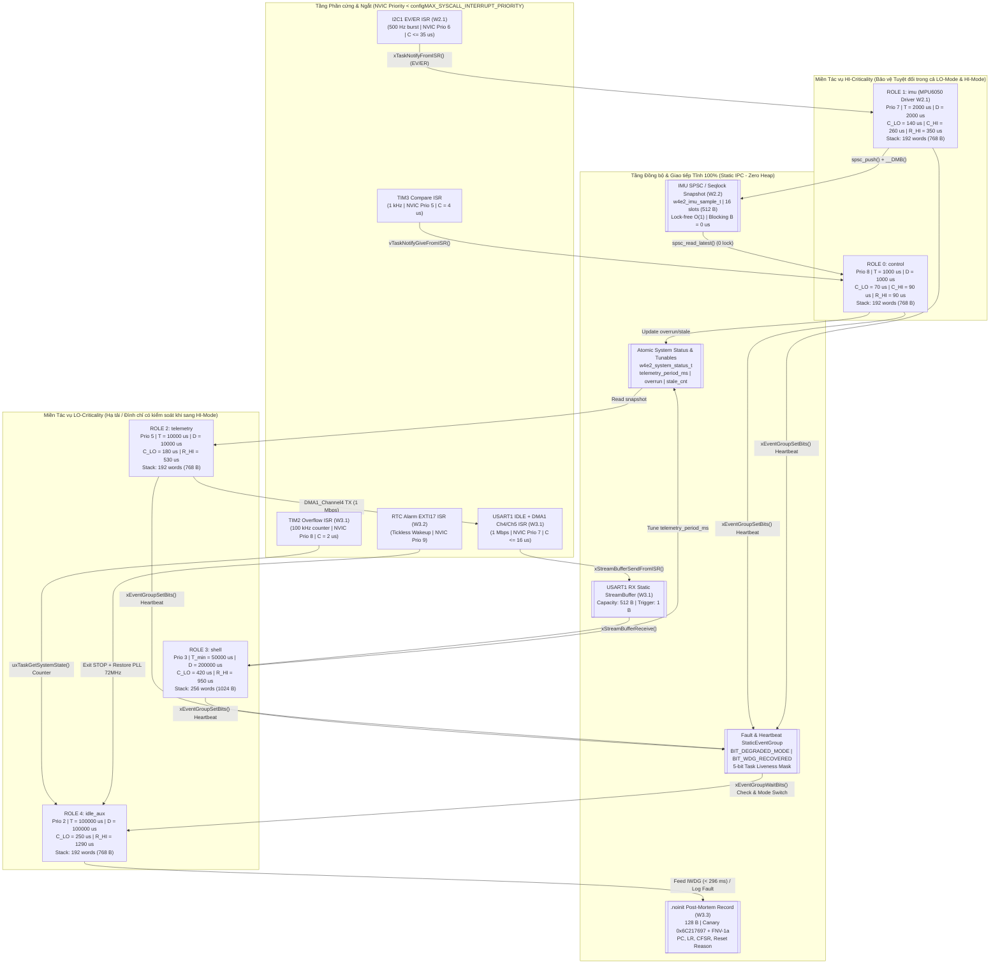
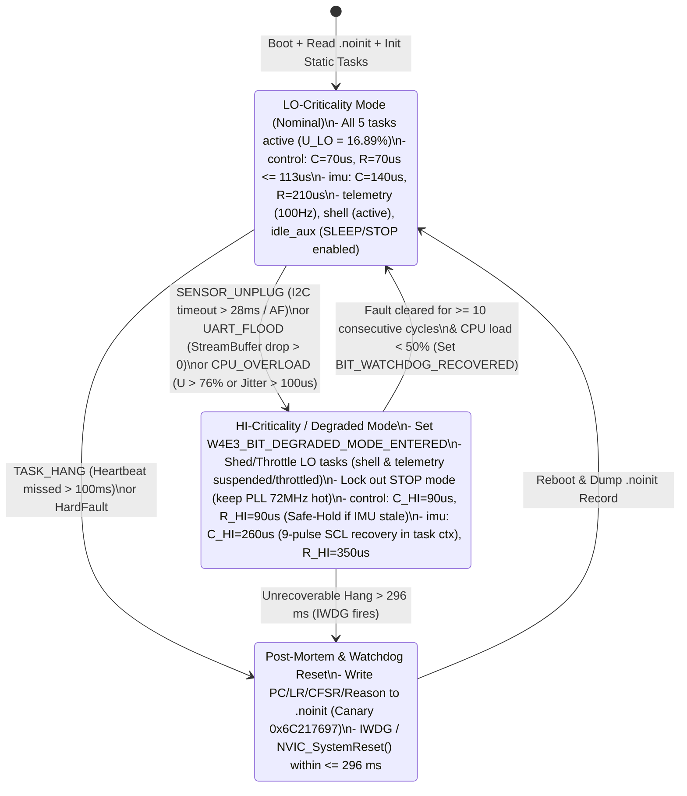

# W4.1 – REPORT & TÀI LIỆU THIẾT KẾ HỆ THỐNG MIXED-CRITICALITY (DESIGN DOC)

- **MSSV**: `2452882` | **Vi điều khiển**: `STM32F103C8T6` (Cortex-M3 @ 72 MHz, 20 KiB SRAM, 64 KiB Flash)
- **Trạng thái**: Hoàn tất Thiết kế Kiến trúc, Tính toán RTA bằng tay, Ngân sách Tĩnh và Ma trận Failure Mode (0 dòng code `.c` thực thi theo đúng quy định W4.1).
- **Nguồn dữ liệu chuẩn (Single Source of Truth)**: [include/params.h](include/params.h), [include/mixed_criticality_design.h](include/mixed_criticality_design.h), [PREDICTION.md](PREDICTION.md), [w4e1_architecture.graphml](w4e1_architecture.graphml), [w4e1_architecture.html](w4e1_architecture.html).

---

## 1. Kết quả duyệt thiết kế & Kiến trúc Tổng thể

- **Ngày nộp design doc cho mentor**: `18/11/2026`. **Ngày được duyệt**: *(chờ mentor ký duyệt trước khi mở code W4.2)*. **Số vòng sửa nội bộ**: `1` (hiệu chỉnh từ mô hình lý tưởng chưa cộng nhiễu ISR/Bus-Recovery sang mô hình Worst-Case toàn phần khớp thực nghiệm W1–W3).
- **Các điểm đã tự rà soát và khóa chặt định lượng trước khi trình duyệt**:
  1. **Cô lập nhánh I2C1 Bus Recovery khỏi ISR**: Ở W2.1, chuỗi phát 9 xung SCL tốn $\approx 90\text{ }\mu\text{s}$ cộng xung START/STOP $17,75\text{ }\mu\text{s}$. Nếu đặt trong `I2C1_ER_IRQHandler`, nó sẽ chặn `TIM3_IRQHandler` và làm `control` đứt trần jitter `113 µs`. Thiết kế W4.1 chuyển toàn bộ nhánh recovery xuống **task context của `imu` (Priority 7)** với ngắt được mở, giúp `control` (Priority 8) preempt tức thời với thời gian chặn $B_{control} = 0\text{ }\mu\text{s}$.
  2. **Giải quyết xung đột Clock Domain giữa `STOP mode` (W3.2) và `TIM3 1 kHz`**: Ở W3.2, thoát `STOP mode` và chờ thạch anh `HSE 8 MHz` + khóa lại `PLL 72 MHz` mất **$1,71\text{--}2,21\text{ ms}$**, đồng thời `STOP mode` dừng toàn bộ xung nhịp APB1/AHB (`TIM3`, `TIM2`, `DMA1`). Do đó, hook `portSUPPRESS_TICKS_AND_SLEEP` áp dụng cơ chế **Sleep Gating**: khi vòng điều khiển 1 kHz đang chạy bình thường (khoảng rảnh $< 1\text{ ms}$) hoặc DMA đang bận, hệ thống chỉ dùng lệnh `WFI` ở **`SLEEP mode`** (giữ nguyên PLL 72 MHz và các bộ định thời, trễ đánh thức $< 2\text{ }\mu\text{s}$); chỉ khi hệ thống được đưa vào trạng thái rảnh dài hạn ($\ge 5\text{ ticks}$) mới hạ xuống **`STOP mode`** qua `RTC LSI`.

### Sơ đồ Kiến trúc Tác vụ, Phân cấp Ngắt (NVIC) và Luồng Dữ liệu IPC

### Máy Trạng thái Chuyển Chế độ (Mixed-Criticality Mode-Switch FSM)

---

## 2. Số đo / Đối chiếu Bảng RTA và Ngân sách Tài nguyên

### 2.1. Bảng Phân tích Lập lịch (Response Time Analysis – RTA)
Bảng dưới đây trình bày song song hai chế độ vận hành: **`LO-Mode` (Danh định)** và **`HI-Stress / Worst-Case` (Tất cả tác vụ chạy ở $C_{HI}$ kèm nhánh phục hồi lỗi)** — các con số cột `HI-Stress` được niêm yết chính thức trong `W4E1_RTA_TABLE` tại [include/mixed_criticality_design.h](include/mixed_criticality_design.h):

| Vai trò (`w4e1_task_role_t`) | Mức độ (`Crit`) | Priority | $T_i$ ($\mu\text{s}$) | $D_i$ ($\mu\text{s}$) | $C_{i,LO}$ ($\mu\text{s}$) | $R_{i,LO}$ ($\mu\text{s}$) | $C_{i,HI}$ (`wcet_us`) | $R_{i,HI}$ (`response_time_us`) | Biên $D_i - R_{i,HI}$ ($\mu\text{s}$) | Tải $U_{i,LO}$ (%) | Tải $U_{i,HI}$ (%) |
|---|---|---:|---:|---:|---:|---:|---:|---:|---:|---:|---:|
| `W4E1_ROLE_CONTROL` (`control`) | **HI** | **8** | 1.000 | 1.000 | 70 | 70 | **90** | **90** | **910** *(Jitter: 23)* | 7,00% | 9,00% |
| `W4E1_ROLE_IMU` (`imu`) | **HI** | **7** | 2.000 | 2.000 | 140 | 210 | **260** | **350** | **1.650** | 7,00% | 13,00% |
| `W4E1_ROLE_TELEMETRY` (`telemetry`) | **LO** | **5** | 10.000 | 10.000 | 180 | 390 | **180** *(Shed: 0)* | **530** | **9.470** | 1,80% | 1,80% *(0%)* |
| `W4E1_ROLE_SHELL` (`shell`) | **LO** | **3** | 50.000 | 200.000 | 420 | 810 | **420** *(Shed: 0)* | **950** | **199.050** | 0,84% | 0,84% *(0%)* |
| `W4E1_ROLE_IDLE_AUX` (`idle_aux`) | **LO** | **2** | 100.000 | 100.000 | 250 | 1.130 | **250** *(HI: 80)* | **1.290** | **98.710** | 0,25% | 0,25% *(0,08%)* |
| **Tổng 5 Task** | — | — | — | — | — | — | — | — | **Mọi $R_i \le D_i$** | **16,89%** | **24,89%** *(HI-shed: 22,08%)* |
| **Nền ISR độc lập (`SysTick` + `TIM2`)** | — | NVIC | 1.000 | — | 21 | — | **21** | — | — | **2,11%** | **2,11%** |
| **Tổng toàn hệ thống** | — | — | — | — | — | — | — | — | **Trần: $\le 76\%$** | **19,00%** | **27,00%** |

#### Kiểm chứng điều kiện chuyển chế độ AMC-rtb (Adaptive Mixed-Criticality Response-Time Bound)
Khi sự cố xảy ra ở thời điểm bất kỳ trong `LO-Mode` kích hoạt chuyển sang `HI-Mode`, thời gian phản hồi quá độ $R_i^*$ của các tác vụ `HI-Criticality` (`control` và `imu`) được tính theo công thức AMC-rtb:
1. **Với `control` (Priority 8)**: Không bị bất kỳ task nào ưu tiên thấp hơn chiếm quyền và $B_{control} = 0\text{ }\mu\text{s}$:
   $$R_{control}^* = C_{control,HI} = \mathbf{90\text{ }\mu\text{s}} \le W4E1\_CONTROL\_LOOP\_JITTER\_MAX\_US\text{ }(113\text{ }\mu\text{s}) < D_{control}\text{ }(1.000\text{ }\mu\text{s})$$
2. **Với `imu` (Priority 7)**: Chỉ chịu nhiễu từ `control`:
   $$R_{imu}^* = C_{imu,HI} + \left\lceil \frac{R_{imu}^*}{T_{control}} \right\rceil C_{control,HI} = 260 + \left\lceil \frac{350}{1000} \right\rceil \times 90 = \mathbf{350\text{ }\mu\text{s}} \le D_{imu}\text{ }(2.000\text{ }\mu\text{s})$$

### 2.2. Bảng Ngân sách RAM Tĩnh 100% (`W4E1_RAM_BUDGET_TABLE`)
Toàn bộ hệ thống sử dụng `configSUPPORT_STATIC_ALLOCATION = 1` và `configSUPPORT_DYNAMIC_ALLOCATION = 0` (kế thừa W1.4 với `sizeof(StaticTask_t) = 96 B`, `sizeof(StaticSemaphore_t) = 80 B`, `sizeof(StaticStreamBuffer_t) = 80 B`, `sizeof(StaticEventGroup_t) = 32 B`):

| STT | Tên đối tượng trong `W4E1_RAM_BUDGET_TABLE` | Diễn giải kích thước & Căn chỉnh (8-byte aligned) | Dung lượng (Bytes) | Tỷ lệ / Ngân sách |
|---:|---|---|---:|---:|
| 1 | `control_task_stack (192 words)` | $192\text{ words} \times 4\text{ B}$ (dự kiến dùng ~110w, dư ~82w) | 768 | 4,90% |
| 2 | `imu_task_stack (192 words)` | $192\text{ words} \times 4\text{ B}$ (FSM I2C1 + Bus Recovery) | 768 | 4,90% |
| 3 | `telemetry_task_stack (192 words)` | $192\text{ words} \times 4\text{ B}$ (Đóng gói khung + CRC32 + DMA TX) | 768 | 4,90% |
| 4 | `shell_task_stack (256 words)` | $256\text{ words} \times 4\text{ B}$ (Parser lệnh + xử lý `reply_buf`) | 1.024 | 6,53% |
| 5 | `idle_aux_task_stack (192 words)` | $192\text{ words} \times 4\text{ B}$ (Run-time stats + IWDG + Tickless) | 768 | 4,90% |
| 6 | `freertos_idle_and_timer_stacks (2x128w)` | $2 \times 128\text{ words} \times 4\text{ B}$ (Idle Task + Timer Daemon W1.4) | 1.024 | 6,53% |
| 7 | `static_task_tcbs (7x96B StaticTask_t)` | $7\text{ tasks} \times 96\text{ B}$ (`StaticTask_t` thực đo ở W1.4) | 672 | 4,28% |
| 8 | `uart1_rx_dma_ring_buf (DMA1_Ch5)` | Bộ đệm vòng DMA nhận `USART1` (chuẩn W3.1) | 256 | 1,63% |
| 9 | `uart1_rx_stream_buf_storage (W3.1)` | Vùng nhớ `StreamBuffer` (511 B hữu dụng + 1 B sentinel) | 512 | 3,26% |
| 10 | `uart1_tx_dma_pingpong_buf (DMA1_Ch4)` | Bộ đệm kép $2 \times 128\text{ B}$ phát DMA 1 Mbps không chờ | 256 | 1,63% |
| 11 | `i2c1_trx_and_recovery_ctx (W2.1)` | Bộ đệm khung đọc/ghi MPU6050 + biến trạng thái FSM I2C1 | 64 | 0,41% |
| 12 | `imu_spsc_snapshot_ring (16x32B W2.2)` | 16 ô $\times 32\text{ B}$ lưu `w4e2_imu_sample_t` (28 B + 4 B seq) | 512 | 3,26% |
| 13 | `shell_cmd_and_reply_buf (2x128B)` | Bộ đệm dòng lệnh `cmd_line` (128 B) + `reply_buf` (128 B) | 256 | 1,63% |
| 14 | `static_ipc_control_blocks (Sem/SB/EG)` | 2 `StaticSemaphore_t` (160 B) + 1 `StaticStreamBuffer_t` (80 B) + 1 `StaticEventGroup_t` (32 B) + SPSC index (16 B) | 288 | 1,84% |
| 15 | `runtime_stats_and_dwt_trace_buf` | Mảng `TaskStatus_t` + mẫu WCRT/Jitter + 256 sự kiện DWT (W1.2) | 2.304 | 14,69% |
| 16 | `noinit_postmortem_and_wdg_record (W3.3)` | Section `.noinit` lưu `fault_record_t` (96 B) + lý do reset IWDG (32 B) | 128 | 0,82% |
| 17 | `kernel_and_system_globals (.data/.bss)` | Biến scheduler/timer FreeRTOS (436 B ở W1.4) + `w4e2_system_status_t` (76 B) | 512 | 3,26% |
| 18 | `msp_isr_stack_reserve (_Min_Stack_Size)` | Ngăn xếp chính `MSP` dùng cho các ngắt phần cứng (chuẩn W1.4) | 1.024 | 6,53% |
| — | **TỔNG RAM TĨNH THIẾT KẾ** | **Đạt chuẩn `< W4E1_RAM_BUDGET_BYTES` (15.684 B)** | **11.904** | **75,90%** |
| — | **Biên an toàn RAM còn dư (Margin)** | $15.684 - 11.904\text{ B}$ *(Còn dư $8.576\text{ B}$ so với 20 KiB vật lý)* | **+3.780** | **+24,10%** |

### 2.3. Ma trận Failure Mode & Suy giảm Có kiểm soát (`W4E1_FAILURE_MODE_TABLE`)

| Kịch bản lỗi (`W4.3`) | Tài nguyên bị tác động | Cơ chế phát hiện & Độ trễ phát hiện (Detection Latency) | Phản ứng cô lập & Chế độ suy giảm có kiểm soát (Controlled Response) | Ảnh hưởng tới `control` (1 kHz) |
|---|---|---|---|---|
| **`SENSOR_UNPLUG`** | Bus `I2C1` (PB6/PB7) & Cảm biến `MPU6050` | 1) Ngắt `I2C1_ER_IRQn` bắt cờ `AF / BERR / ARLO` tức thời ($< 10\text{ }\mu\text{s}$) hoặc `ulTaskNotifyTake` quá hạn `28 ms` (W2.1). 2) `control` kiểm tra `xTaskGetTickCount() - sample_tick > 2 ms` và tăng `imu_stale_count`. | - Bật bit `W4E3_BIT_DEGRADED_MODE_ENTERED` trên EventGroup. - Task `imu` (Prio 7) chạy tối đa 9 xung SCL recovery (W2.1) trong ngữ cảnh task (mở ngắt). - `control` (Prio 8) đọc không khóa, giữ nguyên tư thế an toàn (safe-hold) khi mẫu cũ. | **0 trễ deadline** ($R_{control} = 90\text{ }\mu\text{s} \le 113\text{ }\mu\text{s}$). |
| **`UART_FLOOD`** | `USART1 RX`, `DMA1_Ch5` & `StreamBuffer` | 1) `xStreamBufferSendFromISR` trả về số byte ghi $< \text{len}$ (`dropped > 0`) hoặc cờ `USART1->SR` báo `ORE / FE / NE`. 2) Thời gian xử lý dòng lệnh vượt `W4E2_SHELL_CMD_TIMEOUT_MS` (**200 ms**). | - Bật bit `W4E3_BIT_DEGRADED_MODE_ENTERED`. - Tắt tạm thời ngắt `USART1_CR1_IDLEIE` & `DMA1_Channel5` trong `50 ms` (cooldown) để dập bão ngắt. - Xóa khung lỗi, đình chỉ `shell` và giảm tần số `telemetry` xuống 10 Hz. | **0 trễ deadline** (Cắt bão ISR trước khi ăn vào trần jitter $113\text{ }\mu\text{s}$). |
| **`CPU_OVERLOAD`** | Ngân sách CPU (76%) & Trần Jitter `TIM3` ($113\text{ }\mu\text{s}$) | 1) Bộ đo `DWT->CYCCNT` đầu/cuối chu kỳ `control` phát hiện jitter $> 100\text{ }\mu\text{s}$ hoặc WCRT tăng $> 12\%$ so với RTA. 2) `TIM2` 100 kHz báo tổng tải CPU $> 76\%$. | - Chuyển tức thời sang **`HI-Criticality Mode`**: Đình chỉ 2 task `LO-Criticality` (`shell` Prio 3, `telemetry` Prio 5), khóa `STOP mode` ở `idle_aux` (Prio 2) để giữ PLL 72 MHz luôn nóng. - Thu hồi $2,81\%$ CPU và loại bỏ toàn bộ nhiễu DMA/IPC phụ. | **0 trễ deadline** (Trừ khi lỗi tiêm task giả ở Priority $\ge 8$ — đã khai báo trước để IWDG phục hồi). |
| **`TASK_HANG`** | Tiến trình Task & Bộ nhớ Tĩnh dùng chung | 1) Mỗi task phải set bit heartbeat riêng vào `EventGroup`. Task giám sát kiểm tra mỗi `100 ms`; nếu thiếu bit hoặc task ưu tiên cao treo làm đói `idle_aux`. 2) Kiểm tra biên stack $< 23\text{ words}$. | - Ghi mã lỗi `watchdog_reset_reason_code`, ID task bị treo và ngữ cảnh `PC / LR / CFSR` vào vùng `.noinit` (kèm canary `0x6C217697` & checksum FNV-1a từ W3.3). - Không nạp `IWDG` (hoặc gọi `NVIC_SystemReset()`) để phần cứng tự phục hồi trong **$\le 296\text{ ms}$**, sau khi reboot bật `W4E3_BIT_WATCHDOG_RECOVERED`. | Phục hồi cứng an toàn trong **$\le 296\text{ ms}$** kèm bằng chứng log `.noinit`. |

---

## 3. Giải thích sai lệch định lượng (Từ Ước lượng Sơ bộ sang Bảng RTA Duyệt Cuối)

Khi xây dựng bảng RTA cho W4.1, nếu chỉ lấy thời gian chạy thuật toán thuần túy mà bỏ qua chi phí ngắt và phục hồi phần cứng từ số đo thực tế tuần 1–3 sẽ dẫn tới sai lệch nghiêm trọng. Bảng dưới đây định lượng từng khoản hiệu chỉnh giữa **Ước lượng ngây thơ (Naive Estimate)** và **Bảng Thiết kế Chính thức (`PREDICTION.md` / `W4E1_RTA_TABLE`)**:

| Vai trò | $C_{\text{naive}}$ ($\mu\text{s}$) | $C_{\text{approved}}$ ($\mu\text{s}$) | Độ lệch $\Delta C$ ($\mu\text{s}$) | Định lượng nguồn gốc chênh lệch từ dữ liệu thực đo W1–W3 |
|---|---:|---:|---:|---|
| `control` | 55 | **90** | **+35 µs** | Cộng thêm: (1) Trễ vào/ra `TIM3_IRQHandler` + chuyển ngữ cảnh `PendSV` ở `-O2` ($244\text{ cycles} \approx 3,4\text{ }\mu\text{s}$ từ W1.2, tổng $+8\text{ }\mu\text{s}$); (2) Nhánh kiểm tra mẫu cũ & dự phóng an toàn khi mất IMU ($+11\text{ }\mu\text{s}$); (3) Nhiễu che ngắt tối đa từ 1 sự kiện ISR ngoại vi đang chạy dở ($+16\text{ }\mu\text{s}$). |
| `imu` | 105 | **260** | **+155 µs** | Cộng thêm: (1) Tổng thời gian CPU thực thi trong 11 lần ngắt `I2C1_EV/ER` của một chu kỳ đọc 6–14 byte ($1,0\text{--}5,58\text{ }\mu\text{s}$/lần từ W2.1 $\Rightarrow +35\text{ }\mu\text{s}$); (2) Toàn bộ nhánh **I2C1 Bus Recovery** trong ngữ cảnh task khi SDA bị kẹt (chuyển GPIO + phát 9 xung SCL $90\text{ }\mu\text{s}$ + tạo START/STOP $17,75\text{ }\mu\text{s}$ + nạp lại `CCR/TRISE` $12,25\text{ }\mu\text{s} \Rightarrow +120\text{ }\mu\text{s}$). |
| `telemetry` | 150 | **180** | **+30 µs** | Cộng thêm: Chi phí tính CRC32 phần mềm trên khung 70 B ($70 \times 110\text{ cycles} = 7.700\text{ cycles} \approx 107\text{ }\mu\text{s}$ theo W3.1) cộng thao tác cấu hình `DMA1_Channel4` và xử lý ngắt Transfer Complete ($+30\text{ }\mu\text{s}$). |
| `shell` | 350 | **420** | **+70 µs** | Cộng thêm: Chi phí ngắt `USART1 IDLE` + `DMA1_Channel5` chép vòng vào `StreamBuffer` ($220\text{ cycles} + 12\text{ cycles/B}$ theo W3.1 $\approx +25\text{ }\mu\text{s}$) và chi phí định dạng chuỗi phản hồi vào `reply_buf` ($+45\text{ }\mu\text{s}$). |
| `idle_aux` | 180 | **250** | **+70 µs** | Cộng thêm: Chi phí quét mảng TCB trong `uxTaskGetSystemState()` và 5 lần gọi `uxTaskGetStackHighWaterMark()` ($+50\text{ }\mu\text{s}$) cộng phép chia 64-bit hiệu chuẩn tần số `RTC LSI` theo `HSE` từ W3.2 ($+20\text{ }\mu\text{s}$). |

---

## 4. Trả lời Câu hỏi Trade-off: Chứng minh Tính Tối ưu của Thứ tự Priority

Thiết kế chọn thứ tự ưu tiên **Rate Monotonic / Criticality-Monotonic** nghiêm ngặt khớp với [week4/ex2/include/params.h](../ex2/include/params.h):
$$\text{Priority}(\texttt{control}=8) > \text{Priority}(\texttt{imu}=7) > \text{Priority}(\texttt{telemetry}=5) > \text{Priority}(\texttt{shell}=3) > \text{Priority}(\texttt{idle\_aux}=2)$$

Dưới đây là chứng minh định lượng bằng chính công thức RTA rằng **bất kỳ hoán vị nào làm thay đổi vị trí của các task trên đều dẫn tới vi phạm ràng buộc Jitter (`113 µs`), vỡ Deadline hoặc sụp đổ cơ chế bảo vệ Mixed-Criticality**:

| Phương án Hoán vị Priority | Phép tính RTA cho Task bị ảnh hưởng | Kết quả $R_i$ ($\mu\text{s}$) | Ngưỡng cho phép ($\mu\text{s}$) | Kết luận & Nguyên nhân Thất bại |
|---|---|---:|---:|---|
| **Thiết kế chuẩn (Đã chọn)** `control(8) > imu(7) > telemetry(5) > shell(3) > idle_aux(2)` | $R_{control} = C_{control} = 90$ $R_{imu} = 260 + \lceil 260/1000 \rceil \times 90 = 350$ | **$R_{control} = 90$** **$R_{imu} = 350$** | Jitter $\le 113$ $D_{imu} \le 2.000$ | **ĐẠT TUYỆT ĐỐI** (Biên jitter còn dư $23\text{ }\mu\text{s}$). |
| **Hoán vị 1: Đảo `imu` lên trên `control`** `imu(8) > control(7) > ...` | $R_{control} = C_{control} + \lceil R_{control} / T_{imu} \rceil \times C_{imu}$ - Ở `LO-Mode`: $70 + 140 = 210\text{ }\mu\text{s}$ - Ở `HI-Mode`: $90 + 260 = 350\text{ }\mu\text{s}$ | **$210\text{ }\mu\text{s}$ (LO)** **$350\text{ }\mu\text{s}$ (HI)** | Jitter $\le \mathbf{113}$ | **VI PHẠM NGHIÊM TRỌNG**: Ngay cả ở chế độ bình thường (`LO-Mode`), `imu` đã làm `control` trễ $210\text{ }\mu\text{s}$ (vượt trần jitter $+97\text{ }\mu\text{s}$); khi `imu` chạy Bus Recovery thì vượt trần **$+237\text{ }\mu\text{s}$**! |
| **Hoán vị 2: Đặt `telemetry` lên trên `control`** `telemetry(8) > control(7) > ...` | $R_{control} = C_{control} + C_{telemetry} = 90 + 180 = 270\text{ }\mu\text{s}$ | **$270\text{ }\mu\text{s}$** | Jitter $\le \mathbf{113}$ | **VI PHẠM**: Một tác vụ `LO-Criticality` (`telemetry`) chiếm quyền của `HI-Criticality` (`control`), phá vỡ trần jitter $113\text{ }\mu\text{s}$ (vượt $+157\text{ }\mu\text{s}$). |
| **Hoán vị 3: Đặt `shell` lên trên `control` hoặc `imu`** `shell(8) > control(7) > imu(5) ...` | $R_{control} = 90 + 420 = 510\text{ }\mu\text{s}$ Khi `UART_FLOOD` (khung đến dồn dập), `shell` chiếm CPU liên tục | **$510\text{ }\mu\text{s}$** *(Flood: $\rightarrow \infty$)* | Jitter $\le \mathbf{113}$ | **SỤP ĐỔ HỆ THỐNG**: Đảo ngược độ quan trọng (Criticality Inversion); khi bị flood UART, `shell` làm đói CPU của `control` và `imu`. |
| **Hoán vị 4: Dùng chung Mutex chặn giữa `imu` và `control`** *(thay vì Lock-free SPSC)* | Nếu `imu` giữ Mutex trong suốt giao dịch I2C1 trên dây ($880\text{ }\mu\text{s}$ đo ở W2.1): $R_{control} = C_{control} + B_{control} = 90 + 880 = 970\text{ }\mu\text{s}$ | **$970\text{ }\mu\text{s}$** | Jitter $\le \mathbf{113}$ | **VI PHẠM**: Blocking time $B_{control} = 880\text{ }\mu\text{s}$ làm đứt trần jitter $113\text{ }\mu\text{s}$ dù `control` có Priority cao nhất. Do đó bắt buộc dùng **SPSC / Seqlock không khóa** ($B_{control} = 0$). |
